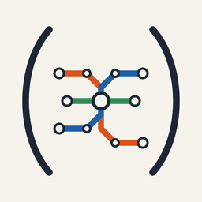
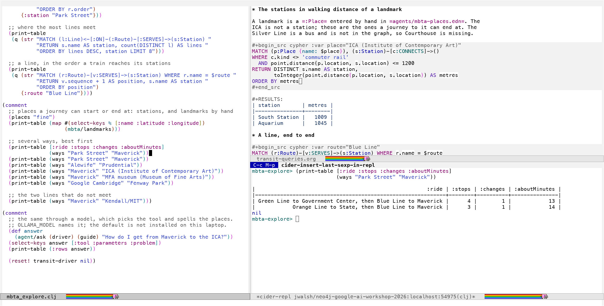
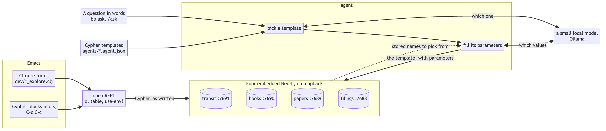

#+TITLE: Graphs from a REPL
#+SUBTITLE: Neo4j, Clojure and Emacs on one machine, begun at a workshop
#+STARTUP: overview

[[https://clojure.org][https://img.shields.io/badge/Clojure-1.13.0--alpha8-5881D8.svg]]
[[https://babashka.org][https://img.shields.io/badge/babashka-tasks-E2231A.svg]]
[[https://neo4j.com][https://img.shields.io/badge/Neo4j-embedded-018BFF.svg]]
[[https://docs.cider.mx][https://img.shields.io/badge/Emacs-CIDER%20%2B%20org--babel-7F5AB6.svg]]
[[https://ollama.com][https://img.shields.io/badge/model-local%2C%20Ollama-000000.svg]]

Four embedded Neo4j graphs on one machine, explored from a REPL. Clojure
forms and Cypher blocks in org files go through the same nREPL; a small
local model picks a query template and never writes Cypher.

Forms and org blocks send Cypher as written. A question in words takes the
upper path: the model picks a template and its parameters, and a person
wrote the Cypher that runs.

* Run it

The transit graph needs no account. =bb local-mbta= and =bb repl= run until
ctrl-c, so each gets its own terminal.

#+begin_src sh
bb mbta network     # fetch the MBTA's GTFS feed and cut the rail network from it
bb local-mbta       # an embedded Neo4j on bolt://localhost:7691
bb mbta-load        # stations, stops, routes, lines, landmarks
bb repl             # an nREPL for Emacs to join
#+end_src

In Emacs, =M-x load-file= on =workshop.el= at the root, then
=M-x workshop-repl=: the transit page on the left, the REPL on the right.
It needs CIDER; =cypher-mode= colours the org blocks and is optional. A JVM
and babashka are the only other requirements.

* Four ways in

- *Forms.* =dev/mbta_explore.clj= and =dev/books_explore.clj= are pages of
  =(comment ...)= blocks: put the cursor after a form and evaluate it.
  =(ways "Park Street" "Maverick")= returns rows; =print-table= shows them.
- *Cypher in org.* =workshop.el= makes =cypher= a language org-babel runs.
  =C-c C-c= on a =#+begin_src cypher :graph transit= block sends the
  statement through the same REPL and writes the rows under the block; each
  =:var= is a query parameter. [[file:notes/transit-queries.org][notes/transit-queries.org]] is a file of them.
- *The shell.* =bb tasks= lists every command: =bb counts=,
  =bb cypher FILE=, =bb ask --agent mbta "..."=, the =local-*= servers and
  their =*-load= tasks. =WORKSHOP_ENV=mbta-graph.env= names the graph.
  =bb annotate= keeps notes on the books.
- *A sentence.* =OLLAMA_MODEL=qwen2.5:3b bb dashboard=, then =/ask= with
  the transit agent chosen: "How do I get from Maverick to the ICA?"

=M-x workshop-graph= points the REPL's =q= at another graph and opens its
page. It evaluates =(use-env! "books-graph.env")=; there is one REPL
throughout.

* The graphs

| graph   | holds                                        | start             | load              | page                    | note        |
|---------+----------------------------------------------+-------------------+-------------------+-------------------------+-------------|
| transit | the MBTA's rail network from its GTFS feed   | =bb local-mbta=   | =bb mbta-load=    | =dev/mbta_explore.clj=  | [[file:notes/transit.org][transit]]     |
| books   | a shelf of books: headings, terms, concepts  | =bb local-books=  | =bb books-load=   | =dev/books_explore.clj= | [[file:notes/books-shelf.org][books]]       |
| papers  | arXiv papers a bibliography names, citations | =bb local-papers= | =bb papers-load=  | =dev/explore.clj=       | [[file:notes/system.org][system]]      |
| filings | one day of SEC Form 13 filings, Lab 4's file | =bb local=        | =bb form13 load=  | =dev/explore.clj=       | [[file:notes/local-first.org][local first]] |

Ports 7691, 7690, 7689 and 7688 in that order: one Neo4j Community server
and one store each. A shell command reaches one through its env file, as in
=WORKSHOP_ENV=local-graph.env bb form13 load=. Transit and filings fetch
public data. Books and papers read a cache the owner fills from their own
library and bibliography; none of that is in the repository.
[[file:notes/system.org][The system as built]] has the whole picture.

* A question through a model

=agents/registry.edn= ties each graph to an agent: a file of named Cypher
templates. A question goes to a local model twice: once to pick a template,
once to fill its parameters from a list of the values the graph holds, so
"Kendall" becomes "Kendall/MIT". The template runs; the rows are the
answer. The model never writes Cypher, and an argument the question does
not support is dropped. A wrong choice of template is not caught.

It is measured: =experiments/013-laptop-models= has two small models on 42
questions, 38 and 40 right when asked twice. =OLLAMA_URL= and
=OLLAMA_MODEL= choose the model; the default named in the code may not be
installed, so name one.

* The dashboard

=bb dashboard= serves =http://127.0.0.1:8377/=, loopback only: an overview
of every graph in the registry, =/map= for the transit stations where they
are, =/data= for five questions of the filings graph, =/ask= for a question
to any agent, =/traces= for what every statement cost, and =/config= for
the connection checks.

* Experiments

=experiments/NNN-name/= is where something is tried before it is built:
each has a hypothesis, a gate set beforehand, a result and a dated log,
and several did not pass. [[file:experiments/README.org][The list]] has fourteen. What survives is
rewritten into =src/workshop/=.

* The workshop

"AI Workshop with Neo4j and Google", Boston AI Developers Group through
AICamp, Google Cambridge, 2026-10-08. Speakers: Ben Lackey, Neo4j, and
Upasana Pati, Google. https://www.aicamp.ai/event/eventdetails/W2026100810

The lab's own instructions live in its repository, linked under Materials.
Nothing of theirs is copied here: slides worth keeping are redrawn as
diagrams, and a statement or prompt taken from a lab is marked as theirs.
[[file:notes/writeup-2026-10-08.org][The write-up]] is the day in one page; [[file:notes/v2-cli-path.org][the labs again, by code]] says per
lab what was done in a console and what can be done from here.

The lab account, project and instance expired on 2026-10-08 at 21:20 EDT.
Commands that need the instance fail until =.env= names another.

** Materials

- Lab repository: https://github.com/neo4j-partners/hands-on-lab-neo4j-and-google
  (Apache 2.0). =ghq get= it and read each lab at
  =assignment-N-*/lab-N-*/docs/README.md=. The lectures there are embedded
  Google Slides, one link per =lecture-*/docs/README.md=.
- Datasets, public objects in the =neo4j-datasets= bucket under
  =https://storage.googleapis.com/neo4j-datasets/hands-on-lab/=:
  - =form13-2023-05-11.csv=, one day of SEC Form 13 filings, Lab 4's first load
  - =form13-2023.csv=, the year. Lab 4's text says its second load uses this; its statements name the day file again
  - =Apple_10-K_2025_2_pages.pdf=, Lab 6

The data is quarterly filings to SEC EDGAR by asset managers with over $100m
under management: who holds what.

** Lab tooling

=gmake help= lists the targets: =gmake agenda= and =gmake todos= read
[[file:notes/assignments.org][the checklist]], =gmake .env= starts a credentials file, =gmake ping= and
=gmake cypher FILE=...= need no JVM. =bb form13= explores Lab 4's file with
no database. =bb labs= is each lab as a step returning data and =bb audit=
checks the notes against the repository; =dev/labs_explore.clj= walks both.
=bb status= runs every connection check once. Queries run are in =labs/=,
prompts typed into a model in =prompts/=, and what bit in
=.meta/findings.md=.

* Notes

In =notes/=, one file per session or topic. The system first:

- [[file:notes/system.org][The system as built]]: four embedded graphs, a registry of agents, the path of a question through a local model, and what runs on which port
- [[file:notes/transit.org][Transit]]: the MBTA's rail network from its GTFS feed as stations, stops, routes and lines, a map drawn from it, Maverick to Kendall, and several ways between two places with landmarks for ends
- [[file:notes/transit-queries.org][Transit, a query at a time]]: Cypher blocks in an org file run through the REPL with their results, and the stations a walk from a landmark
- [[file:notes/books-shelf.org][A shelf of books as a graph]]: 29 books on the workshop's subjects as headings, terms and the concepts in their own indexes, explored from Emacs, with why two books come out similar, and notes kept on them outside the repository
- [[file:notes/local-first.org][The lab, local first]]: the same path with an embedded Neo4j and a small local model, lab by lab, and what does not carry over
- [[file:notes/telemetry.org][Telemetry]]: spans around every statement, check and lab step, and the dashboard's Data and Traces pages
- [[file:notes/project-setup.org][Setting a project up]]: the order this one was set up in, from conventions to a hosted page, with what each step is proven to do, which are still on unreviewed branches, and what breaks when it is repeated for many projects
- [[file:notes/review-checklist-2026-10-11.org][Review checklist]]: what to decide before more is built, in six lists: what landed, the integrated view and debugging, a student's first five minutes, signing in and a preference, datasets to add, and what nobody looked at
- [[file:notes/data-sources.org][Other data sources]]: fifteen public datasets checked by request, ranked, with what a dataset-agnostic loader would need from each

The workshop record:

- [[file:notes/assignments.org][Assignments]]: the class page's lectures and labs as a checklist, all ticked, which =gmake agenda= and =bb audit= read
- [[file:notes/architecture.org][What gets built]]: the architecture slide and where each lab sits on it
- [[file:notes/lab-02-deploy-neo4j.org][Lab 2 - Deploy Neo4j]]: the path taken, where it left the lab's text, and the check
- [[file:notes/lab-03-connect-to-neo4j.org][Lab 3 - Connect to Neo4j]]: Connect, Query, and =SHOW DATABASES= two ways
- [[file:notes/lab-04-query.org][Lab 4 - Query]]: the naive load, the keyed load, the counts, and what the file says locally
- [[file:notes/lab-05-bloom.org][Lab 5 - Bloom]]: the path, the search, Degree Centrality sized on the scene, and degree without Bloom
- [[file:notes/lab-06-document-intelligence.org][Lab 6 - Document Intelligence]]: why this account does not have the tool, and the same result through the LLM Graph Builder's API
- [[file:notes/lab-07-deploy-neo4j-agent.org][Lab 7 - Deploy Neo4j Agent]]: the marketplace path into Gemini Enterprise, the agent's A2A card, and the check
- [[file:notes/lab-08-use-neo4j-agent.org][Lab 8 - Use Neo4j Agent]]: the three prompts, the lazy authorization, and what the shared database turned out to hold
- [[file:notes/lab-09-aura-agents.org][Lab 9 - Aura Agents]]: the generated agent and its exported tools, and its answers checked against the database
- [[file:notes/writeup-2026-10-08.org][Write-up, 2026-10-08]]: the day in one page: what the labs do, what held, what did not, and how to run it again
- [[file:notes/review-framework-2026-10-08.org][Review as a framework, 2026-10-08]]: what a next workshop would copy from this repository, and ten changes that would make the copy cheap
- [[file:notes/review-2026-10-08.org][Review, 2026-10-08]]: the work read as one design, with the five forms of one fact drawn
- [[file:notes/v2-cli-path.org][The labs again, by code]]: per lab, the console path, the CLI or API path, whether it ran here, and what the rest need
- [[file:notes/lecture-gemini-enterprise.org][Lecture - Gemini Enterprise]]: the Agent Platform slide, redrawn
- [[file:notes/lecture-neo4j-and-ai.org][Lecture - Neo4j and AI]]: two reference architectures, redrawn
- [[file:notes/screens.org][Screens]]: the consoles and the dashboard as they stood, for after the lab expires
- [[file:notes/resources.org][Resources from the slides]]: the Dataflow template and the Dataproc notebooks

* Licence

Apache 2.0, in =LICENSE=. =NOTICE= says which text is the lab's and under
what terms.
