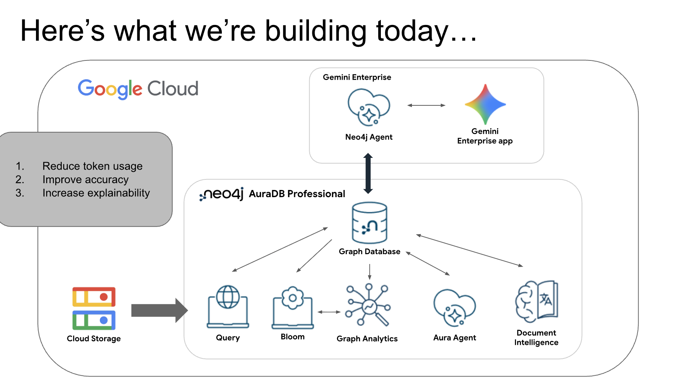

* What gets built

From the slide "Here's what we're building today…".

Everything runs in Google Cloud.

- Cloud Storage holds the source data and is loaded into Neo4j.
- Neo4j AuraDB Professional holds the graph database. Around it: Query,
  Bloom, Graph Analytics (drawn next to Bloom, fed from the database), an
  Aura Agent, and Document Intelligence.
- Gemini Enterprise holds a Neo4j Agent, which talks to the graph database
  below it and to a Gemini Enterprise app beside it.

The three stated aims of putting a graph under the agent:

1. Reduce token usage
2. Improve accuracy
3. Increase explainability

Where the labs land on the picture: Labs 2 and 3 are the database, Lab 4 is
Query, Lab 5 is Bloom, Lab 6 is Document Intelligence, Labs 7 and 8 are the
Neo4j Agent in Gemini Enterprise, Lab 9 is the Aura Agent. No lab is named
for Graph Analytics.
