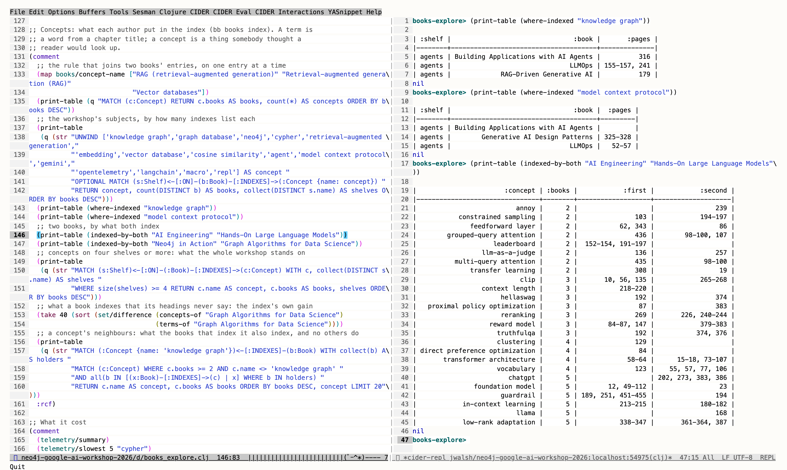

#+TITLE: A shelf of books as a graph, read from Emacs
#+DATE: 2026-10-09

Ours, the day after the workshop. A third data source, and the workshop
looked at from its bookshelf: =shelves/homage.edn= is 29 books from the
owner's library on what the labs were about. Graphs, agents, the cloud it
ran on, telemetry, and Clojure. There is no Emacs book in the library; a
Common Lisp one stands in.

* What is where

| what                              | where                                   | in the repository |
|-----------------------------------+-----------------------------------------+-------------------|
| the shelf: ids, titles, reasons   | =shelves/homage.edn=                    | yes               |
| the catalog of the whole library  | =$XDG_CACHE_HOME/workshop-books/=       | no                |
| the 29 PDFs, as =<id>.pdf=        | the same cache, =pdf/=                  | no                |
| their outlines                    | the same cache, =outlines.edn=          | no                |
| the graph                         | a third embedded Neo4j, port 7690       | no                |

The cache's file names are the shelf's ids, so another person's copies,
whatever they are called, land in the same layout: put your own file names
in the shelf's =:file= lines, or drop =<id>.pdf= files into =pdf/=.

#+begin_src sh
BOOKS_DIR=~/Books bb books catalog          # pdfinfo over a directory; BOOKS_HOST for one over ssh
bb books fetch                              # the shelf's books into the cache, once each
bb books outline                            # their bookmarks, with pdftohtml
bb local-books                              # leave running
bb books-load
bb ask --agent books Which books mention telemetry
#+end_src

* What the graph is

=(:Shelf)<-[:ON]-(:Book)-[:HAS]->(:Heading)-[:HAS]->(:Heading)= and
=(:Heading)-[:ABOUT]->(:Term)=. 29 books, 7,036 headings, 1,475 terms. A
term is a word, or a run of two or three, that the headings of at least two
books use. No book's text is read and no model is involved: similarity by
meaning is an embedding's job and other tools do it. This is the projection
a graph database holds without one, and its use is that every number in it
opens up into headings and page numbers.

* From Emacs

=dev/books_explore.clj= is a page of =(comment ...)= blocks. =bb repl= in one
tmux window, Emacs in another, =cider-connect-clj=, and a form at a time.
The pictures are that session: keys sent to the pane, the pane's text and
colours rendered to an image. A person was not at the keyboard. The theme
is Emacs's own modus-operandi; the font and the exact shades are the
renderer's.

[[file:img/emacs-books-why-similar.png]]

Why two books are similar. /Linked Data/ and /Neo4j in Action/ share a fifth
of their vocabulary; =why-similar= opens that into the terms and a heading
from each. "query" is SPARQL in one and traversals in the other, "node" is a
blank node in one and an index entry in the other. The score says they are
near; the table says about what, and that "listing" is in there because
Manning's outlines include every code listing's caption.

[[file:img/emacs-books-words-by-shelf.png]]

The workshop's own words, placed on the shelves. "agent" is in nine books of
the agents shelf and three of the Clojure one, where it means something
else. "graph" appears on four shelves. "telemetry" is 80 headings in two
books.

[[file:img/emacs-books-rule-and-difference.png]]

Left, the rule that makes a term, evaluated on one heading: this is the
whole of the "model", and it can be changed and run again in place. Right,
the terms one of two similar books has and the other lacks, as a set
difference in Clojure.

* Concepts, from each book's own index

The terms above are words from headings, and the words beside "knowledge
graph" were "completion", "interacting" and "building". An index is the
author's own list of what the book is about. =bb books index= reads the
pages each outline says the index is on, with word positions, and keeps
the main entries: one that starts at its column's left edge. Sub-entries
are indented and left out (=experiments/012-book-index=).

| What                                   | Count |
|----------------------------------------+-------|
| Books with an index read               | 24 of 29 |
| Concepts                               | 8,288 |
| in two books or more                   | 777   |
| in four books or more                  | 132   |
| Terms, with single-book ones now kept  | 4,340 (1,475 shared) |

The graph gains =(:Book)-[:INDEXES {pages}]->(:Concept)=, and a Term gains a
=books= property: a word only one book's headings use is kept as that
book's own vocabulary, and a query about a pair of books asks for
=books >= 2=.

This reads a few pages of each book, which the projection had not done
before. What is kept is entry names and page numbers, in the cache with
the outlines, not in the repository.

The same session, the concepts block of =dev/books_explore.clj=. Top right,
who indexes "knowledge graph" and "model context protocol": three books
each, all on the agents shelf, none on the graphs shelf. Below, what /AI
Engineering/ and /Hands-On Large Language Models/ both index, rarest on the
shelf first, with the pages each gives: "grouped-query attention",
"llm-as-a-judge", "reranking". Heading words could not have said that.

What it showed:

- "retrieval-augmented generation" is indexed by eight books, "agent" by
  nine, "vector database" by six, "cosine similarity" by five.
- "gemini" is in three indexes. BigQuery and Vertex AI are in none: the
  shelf has no Google Cloud book.
- "cypher" is a concept in one index only, /Graph Algorithms for Data
  Science/. /Neo4j in Action/'s index lists its clauses one by one and never
  the language.
- The concepts on four shelves or more are "metadata", "consistency",
  "state", "concurrency", "pipeline": what the workshop's subjects stand
  on, and nothing the workshop named.

The books agent has a sixth tool over the indexes. It was not tried with a
model: on 2026-10-09 afternoon no JVM or babashka process on the laptop
could reach the model's host ("No route to host"), while curl could.

* What the first look showed

- The most similar pairs are the expected ones: the three Clojure books,
  the LLM operations books, /Linked Data/ with /Neo4j in Action/.
- /Neo4j in Action/'s nearest neighbours after /Linked Data/ are /Terraform in
  Action/ and /GraphQL in Action/, ahead of /Graph Algorithms for Data
  Science/. That is the publisher, not the subject: three Manning "in
  Action" books share "listing", "figure" and a house style of heading.
  The graph shows it; a score alone would not.
- A tagger makes better terms than the rule in two ways and worse in one
  (=experiments/011-heading-terms=). The phrases were worth porting.

* Notes on a book

Ours, added 2026-10-10. A note is a book's id, a page, some text, optionally
the passage it is about and the concepts it touches. It is kept as one file,
=<book-id>/<id>.edn=, under =$XDG_DATA_HOME/workshop-books/annotations=
(=~/.local/share/...= when that is unset), or wherever =BOOKS_ANNOTATIONS=
says. That is the data directory, not the cache beside the PDFs: an outline
can be read out of a PDF again and a note cannot. A note may quote a book,
so none is in the repository.

The page is the PDF's own count, as a viewer shows it and as a heading's
=page= has it, not the printed number an index gives.

#+begin_src sh
bb annotate where                           # the store
bb annotate add neo4j-in-action 40 "..."    # a note; - for no page
bb annotate list [BOOK]
bb annotate merge DIR                       # copy in another store's notes
bb books-load                               # books, then notes, into the graph
#+end_src

From Emacs, =M-x workshop-annotate= asks for the book, the page and the
note, and takes the region as the passage; in a buffer showing a cached PDF
it offers that book and the page in view. =M-x workshop-annotations= shows
one book's notes as an org buffer, which is a view and not the store. At the
REPL it is =(annotate! {:book "..." :page 40 :text "..."})=.

** Writers that do not meet

No file in the store is rewritten. A note is written beside its final name
and renamed, and its id is the second it was written and eight random hex
digits, so two processes writing at once each leave their own file; a test
writes 200 from several threads and reads back 200. That is what lets more
than one agent, or more than one git worktree, write at the same time.

A worktree has none of the ignored files, so anything kept in the checkout
would be missing from it. The store is outside every checkout: all of them
reach the same notes. An agent that should not touch the owner's notes is
started with its own =BOOKS_ANNOTATIONS= (or its own =XDG_DATA_HOME=) and
=WORKSHOP_AUTHOR=, and what it wrote comes back with =bb annotate merge=,
which copies the files the store lacks and overwrites nothing. Each note
says who it is =:by=.

#+begin_src sh
BOOKS_ANNOTATIONS=/tmp/agent-1 WORKSHOP_AUTHOR=agent-1 bb annotate add linked-data 12 "..."
bb annotate merge /tmp/agent-1
#+end_src

The graph is isolated by port, not by store. In the main checkout the books
graph is the one server on 7690, and =bb books-load= replaces its notes with
one store's. A worktree takes ports of its own from the estate's port
registry, [[https://github.com/aygp-dr/portclaim][portclaim]], and runs its own server on them:

#+begin_src sh
export PORTCLAIM=http://<the host running it>:4700
bb ports                  # this checkout's ports, who holds each, what is listening
bb ports claim books      # in a worktree: a slot of ten from 11000, written to .env.ports
bb local-books            # now on that block's port, with the worktree's own store
bb books-load             # books-graph.env means this checkout's books graph
bb ports release          # when the branch merges
#+end_src

=.env.ports= is ignored by git. =workshop.env= reads it, so a graph profile's
loopback port becomes the block's and the profile itself is not edited; the
embedded server's store is under the checkout already. There are a hundred
slots, 11000 to 11999. A branch is offered the one a checksum of its name
picks, so the same branch has the same ports everywhere; if the registry
holds a port in it, or something listens there, the next slot is taken
instead. Only the services named are claimed. The main checkout keeps 8377
and 7688 to 7691.

Checked on 2026-10-10: =bb ports= against the running registry, the block a
worktree would be given, and the slot rule and port rewriting by tests. Not run: a
claim, a release, or a server on a block's port. Emacs' =workshop-dashboard=
still opens 8377 whatever the checkout.

** In the graph

: (:Annotation)-[:ANNOTATES]->(:Book)
: (:Annotation)-[:AT]->(:Heading)       the last heading starting on or before its page
: (:Annotation)-[:ABOUT]->(:Concept)    where a book's index has that entry

The load replaces the graph's notes with the store's, so a file deleted
there is gone here. It runs after the books' load, which replaces the
concepts a note points at.

#+begin_src cypher :graph books :eval no
MATCH (a:Annotation)-[:AT]->(h:Heading), (a)-[:ANNOTATES]->(b:Book)
RETURN b.title AS book, a.page AS page, h.title AS section, left(a.text, 40) AS note
ORDER BY book, page
#+end_src

Concepts noted in one book that another book's index also lists, which is
where to read next:

#+begin_src cypher :graph books :eval no
MATCH (a:Annotation)-[:ABOUT]->(c:Concept)<-[i:INDEXES]-(other:Book)
WHERE other.id <> a.book
RETURN c.name AS concept, other.title AS alsoIn, i.pages AS pages LIMIT 20
#+end_src

Checked: the store, the merge, the heading a page falls under and the org
view, by the tests and by =bb annotate= against a scratch store. Not run:
the load into the graph and the two statements above. The graph held no
notes on 2026-10-10 and the owner's store was empty.

* Not done

- Notes loaded into the graph and asked about there: see above.
- A note anchored to a place on the page. It has a page and a passage.
- An agent tool for notes.

- The index's sub-entries and its "see also" lines, which are edges
  between concepts.
- A scored sample of index entries. The quality was looked at, not
  measured.
- The sixth agent tool with a model.
- Captions dropped from the outlines before terms are made.
- Editions folded: the catalog has three versions of some books.
- The two books with no bookmarks. Their contents pages would have to be
  read as text.
- The rest of the library: 308 books in the catalog, 29 on the shelf.
- Any of it against a hosted instance.
