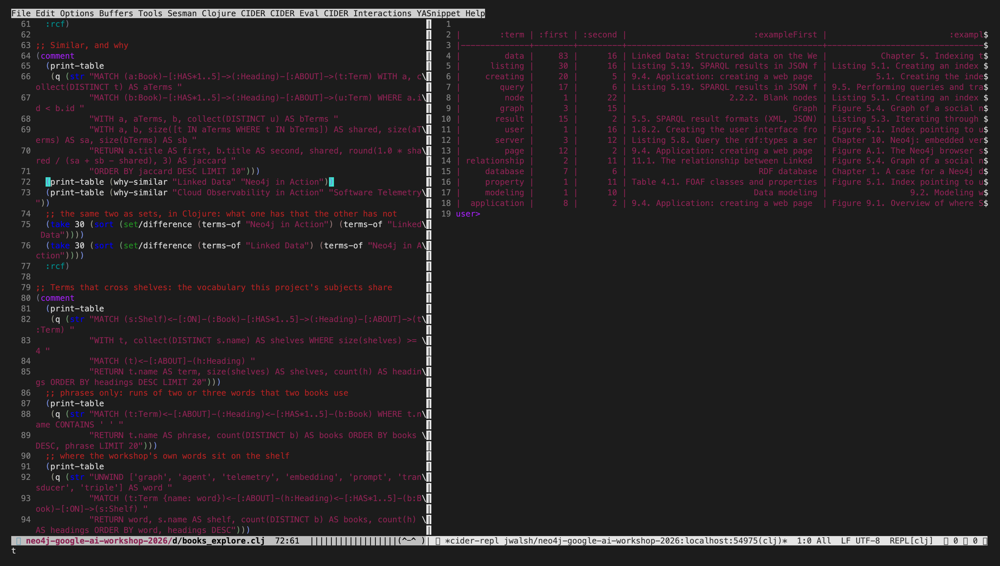
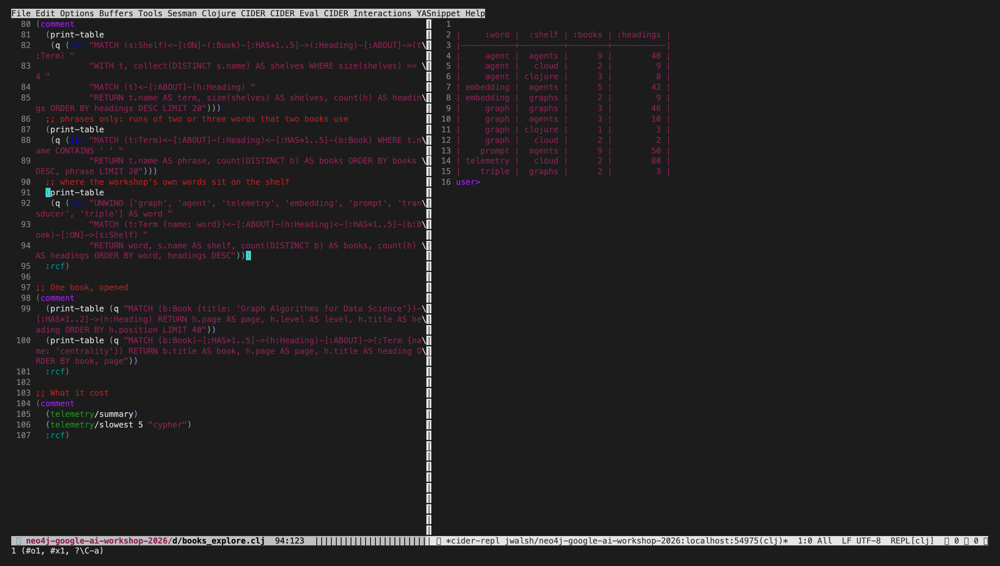
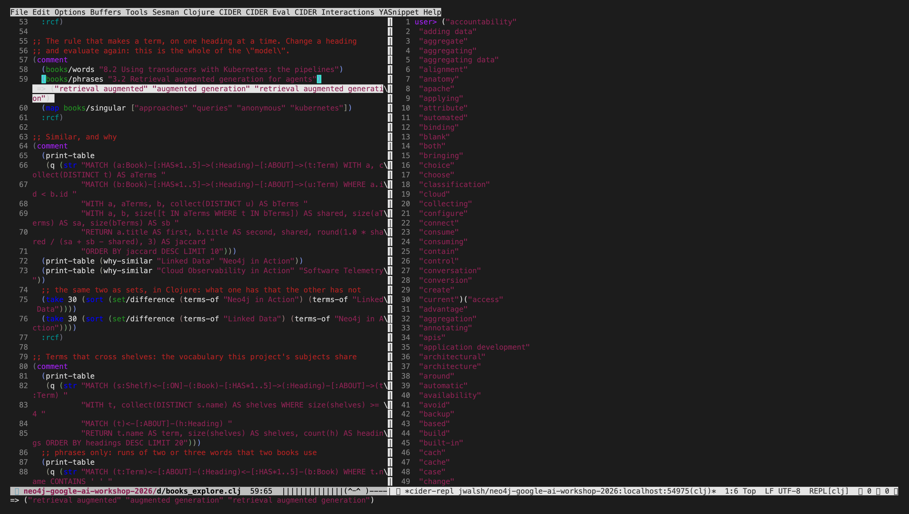

#+TITLE: A shelf of books as a graph, read from Emacs
#+DATE: 2026-10-09

Ours, the day after the workshop. A third data source, and the workshop
looked at from its bookshelf: =shelves/homage.edn= is 29 books from the
owner's library on what the labs were about. Graphs, agents, the cloud it
ran on, telemetry, and Clojure. There is no Emacs book in the library; a
Common Lisp one stands in.

* What is where

| what                              | where                                   | in the repository |
|-----------------------------------+-----------------------------------------+-------------------|
| the shelf: ids, titles, reasons   | =shelves/homage.edn=                    | yes               |
| the catalog of the whole library  | =$XDG_CACHE_HOME/workshop-books/=       | no                |
| the 29 PDFs, as =<id>.pdf=        | the same cache, =pdf/=                  | no                |
| their outlines                    | the same cache, =outlines.edn=          | no                |
| the graph                         | a third embedded Neo4j, port 7690       | no                |

The cache's file names are the shelf's ids, so another person's copies,
whatever they are called, land in the same layout: put your own file names
in the shelf's =:file= lines, or drop =<id>.pdf= files into =pdf/=.

#+begin_src sh
BOOKS_DIR=~/Books bb books catalog          # pdfinfo over a directory; BOOKS_HOST for one over ssh
bb books fetch                              # the shelf's books into the cache, once each
bb books outline                            # their bookmarks, with pdftohtml
bb local-books                              # leave running
bb books-load
bb ask --agent books Which books mention telemetry
#+end_src

* What the graph is

=(:Shelf)<-[:ON]-(:Book)-[:HAS]->(:Heading)-[:HAS]->(:Heading)= and
=(:Heading)-[:ABOUT]->(:Term)=. 29 books, 7,036 headings, 1,475 terms. A
term is a word, or a run of two or three, that the headings of at least two
books use. No book's text is read and no model is involved: similarity by
meaning is an embedding's job and other tools do it. This is the projection
a graph database holds without one, and its use is that every number in it
opens up into headings and page numbers.

* From Emacs

=dev/books_explore.clj= is a page of =(comment ...)= blocks. =bb repl= in one
tmux window, Emacs in another, =cider-connect-clj=, and a form at a time.
The pictures are that session: keys sent to the pane, the pane's text and
colours rendered to an image. A person was not at the keyboard, and the
palette is the renderer's.

Why two books are similar. /Linked Data/ and /Neo4j in Action/ share a fifth
of their vocabulary; =why-similar= opens that into the terms and a heading
from each. "query" is SPARQL in one and traversals in the other, "node" is a
blank node in one and an index entry in the other. The score says they are
near; the table says about what, and that "listing" is in there because
Manning's outlines include every code listing's caption.

The workshop's own words, placed on the shelves. "agent" is in nine books of
the agents shelf and three of the Clojure one, where it means something
else. "graph" appears on four shelves. "telemetry" is 80 headings in two
books.

Left, the rule that makes a term, evaluated on one heading: this is the
whole of the "model", and it can be changed and run again in place. Right,
the terms one of two similar books has and the other lacks, as a set
difference in Clojure.

* What the first look showed

- The most similar pairs are the expected ones: the three Clojure books,
  the LLM operations books, /Linked Data/ with /Neo4j in Action/.
- /Neo4j in Action/'s nearest neighbours after /Linked Data/ are /Terraform in
  Action/ and /GraphQL in Action/, ahead of /Graph Algorithms for Data
  Science/. That is the publisher, not the subject: three Manning "in
  Action" books share "listing", "figure" and a house style of heading.
  The graph shows it; a score alone would not.
- A tagger makes better terms than the rule in two ways and worse in one
  (=experiments/011-heading-terms=). The phrases were worth porting.

* Not done

- Captions dropped from the outlines before terms are made.
- Editions folded: the catalog has three versions of some books.
- The two books with no bookmarks. Their contents pages would have to be
  read as text.
- The rest of the library: 308 books in the catalog, 29 on the shelf.
- Any of it against a hosted instance.
