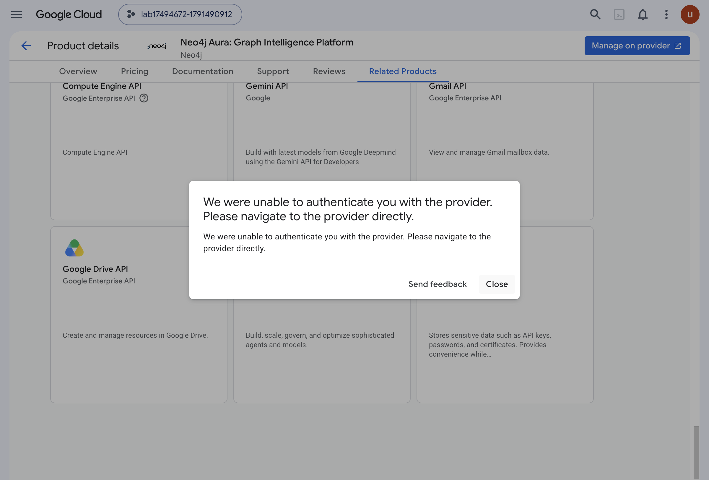
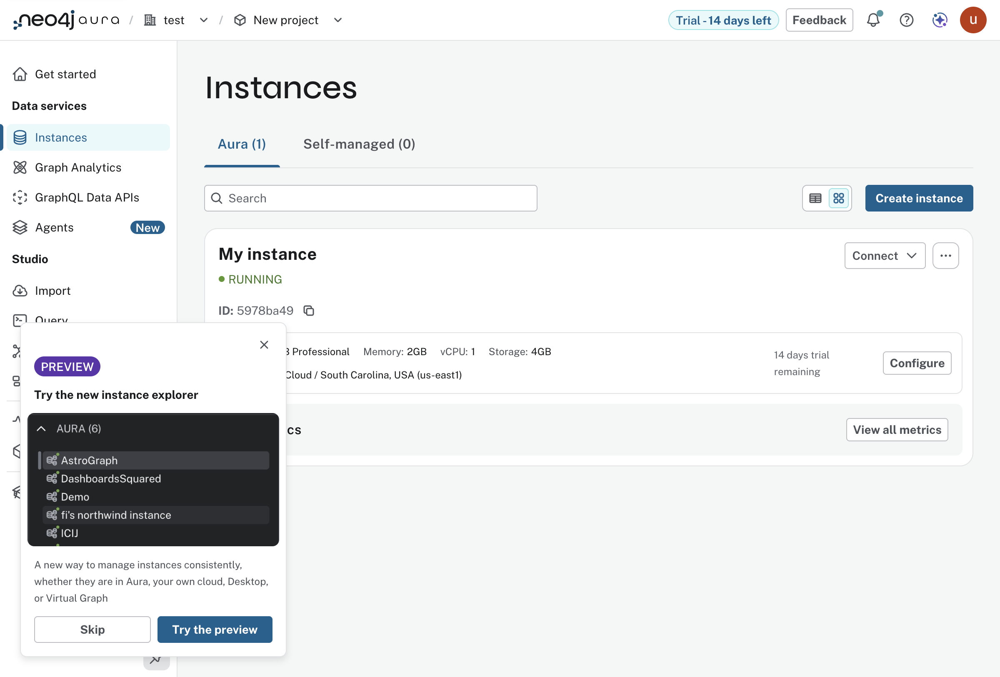

* Lab 2 - Deploy Neo4j

What happened on 2026-10-08, against the lab's own text at
=assignment-1-getting-started/lab-2-deploy-neo4j/docs/README.md= in the lab
repository. Driven partly by an agent over the DevTools protocol in a
Chromium with an empty profile, partly by hand. Where the two differ from the
lab's text, it says so.

** The path taken

1. In the Cloud console, signed in as the lab account with the lab project
   selected, open the listing directly:
   =https://console.cloud.google.com/marketplace/product/neo4j-mp-public/neo4j-aura?project=<project>=.
   The lab searches for "Neo4j Aura"; the URL lands in the same place.
2. The listing reads "Approved" and "Last purchased on 10/6/26": the
   Vocareum organization is already subscribed. Click "Manage on provider".
3. The first click failed:

   

   Close, click again. The second click opened
   =console.neo4j.io/gcp-marketplace-registration/v2?token=...= in a new tab.
   The lab's "you are leaving Google Cloud" dialog did not appear.
4. Aura's sign-up page, "Continue with Google", the lab account, "Continue".
5. Not in the lab's text: an onboarding survey, "Define your goal".
6. Tier: Professional. Region, Graph Analytics and vector options left at
   their defaults. "Create instance".
7. The credentials page. "Download and continue" saves
   =Neo4j-<id>-Created-<date>.txt= to the browser's download directory. It
   holds =NEO4J_URI=, =NEO4J_USERNAME=, =NEO4J_PASSWORD=, =NEO4J_DATABASE=,
   =AURA_INSTANCEID= and =AURA_INSTANCENAME=, the same names as
   =.env.template=. Copy the values into =.env=, quoting the instance name:
   it has a space.
8. Wait. The page said "a couple of minutes"; it was about five before the
   instance answered.

** What came out

One instance, "My instance", RUNNING, AuraDB Professional, 2GB memory, 1
vCPU, 4GB storage, Google Cloud us-east1 (South Carolina). The console
labels it "Trial - 14 days left", in an organization named "test" and a
project named "New project".

** The Configure page

From the instance's "Configure", read and not changed. It says a
configuration change keeps read and write availability.

- Sizing: 2GB memory, 1 vCPU, 4GB storage, marked "14-day free trial".
- Graph Analytics has two modes. "Aura Graph Analytics (recommended)" runs
  algorithms in an on-demand ephemeral compute environment, and is what this
  instance has. "Plugin" shares memory and compute with the database and
  needs 4GB memory or more, so it is not available at this size. This is the
  box the architecture slide draws beside Bloom, the one no lab is named for.
- Additional settings, both off: a vector-optimized configuration for
  GraphRAG and semantic search over embeddings, and multiple databases in one
  instance.

** The check

The lab's check is seeing the instance details in the console, above. Two
more that do not need a browser:

#+begin_src sh
gmake ping
gmake cypher FILE=labs/lab-03-connect.cypher
#+end_src

The first returned =[[1]]=. The second is Lab 3's =SHOW DATABASES= and
returned =neo4j=, online, default, and =system=, online: the two databases
Lab 3 says to expect.

** What bit

=.meta/findings.md=, entries 4 to 13.
