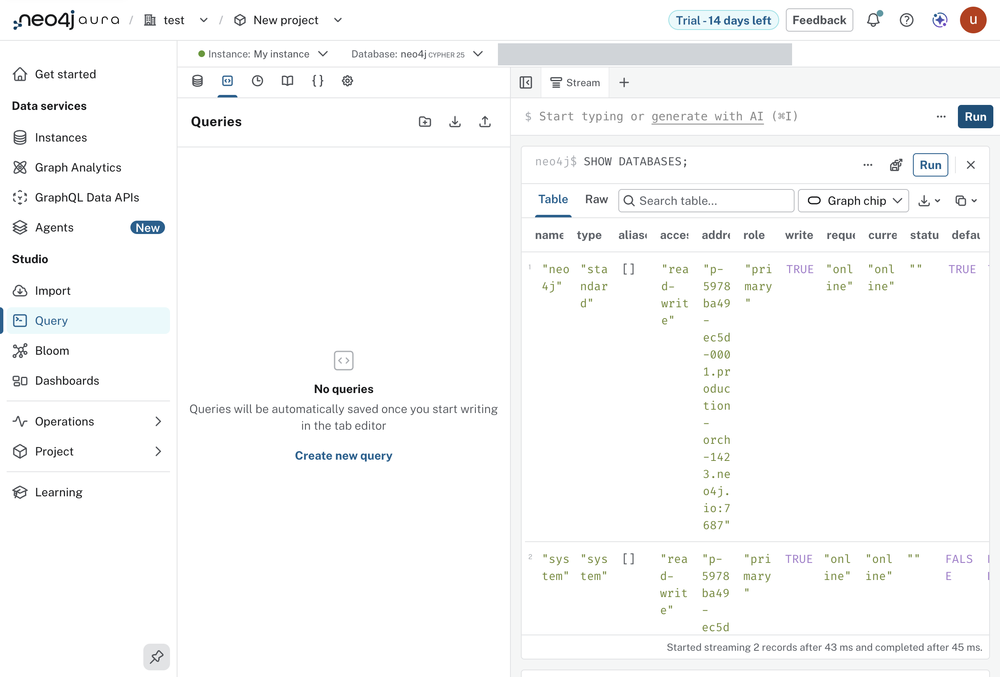

* Lab 3 - Connect to Neo4j

What happened on 2026-10-08, against the lab's text at
=assignment-1-getting-started/lab-3-connect-to-neo4j/docs/README.md= in the
lab repository. Driven by an agent over the DevTools protocol.

** The path taken

1. On the instance card, "Connect", then "Query" in the menu that drops
   from it. The sidebar's "Query" under Studio opens the same tool but
   disconnected: "No instance connected". From there "Connect to instance",
   then "Connect" on the instance in the dialog, gets to the same place.
2. No password is asked. The tool connects as
   =Aura (<lab account>)=, the console's own sign-on, to database =neo4j=,
   shown as "CYPHER 25".
3. The database is empty, as the lab says.
4. =SHOW DATABASES;= in the editor, "Run".

** What came out

Two rows, as the lab says to expect:

| name   | type     | access     | role    | currentStatus | default | home  |
|--------+----------+------------+---------+---------------+---------+-------|
| neo4j  | standard | read-write | primary | online        | true    | true  |
| system | system   | read-write | primary | online        | false   | false |

Streamed 2 records in 45 ms. Both report the address
=p-5978ba49-ec5d-0001.production-orch-1423.neo4j.io:7687=, the host behind
the =<id>.databases.neo4j.io= name in the credentials file.

** The same check without a browser

#+begin_src sh
gmake cypher FILE=labs/lab-03-connect.cypher
#+end_src

That goes in as user =neo4j= with the password from =.env=, where the
console goes in by sign-on. Both see the same two databases.

** What bit

=.meta/findings.md=, entries 14 and 15.
