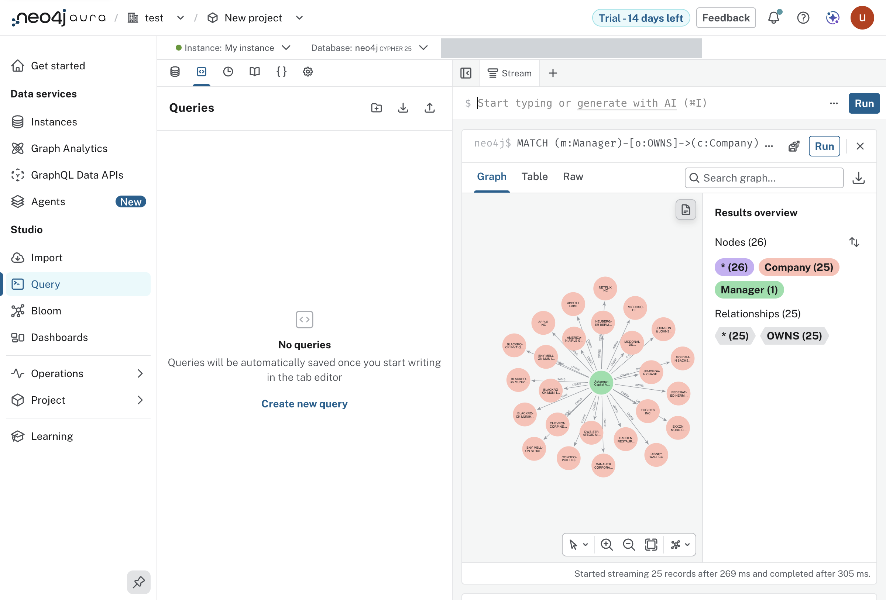
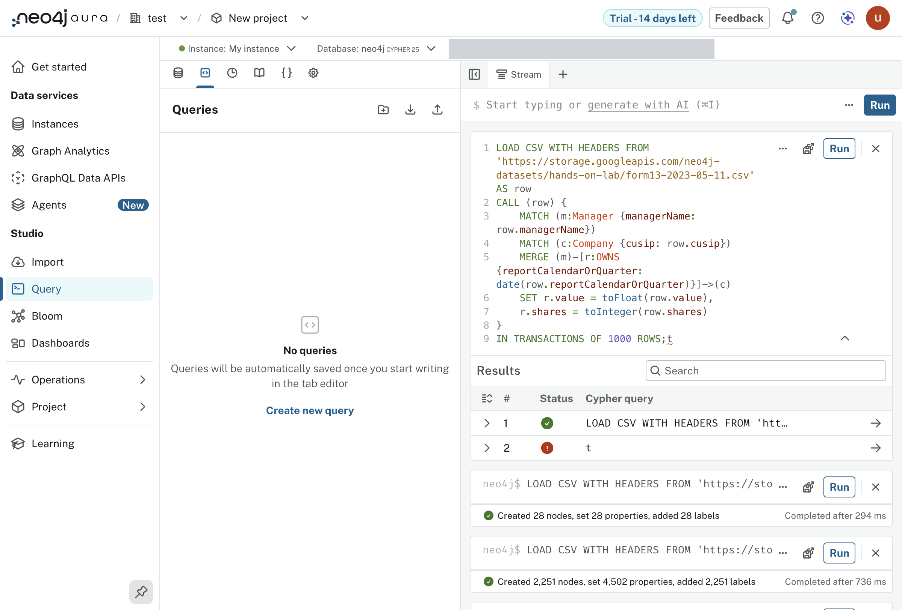

#+TITLE: Lab 4 - Query
#+DATE: 2026-10-08

From the lab text, =assignment-2-moving-data/lab-4-query= in the lab
repository. Driven in the console's Query tool; the statements as run are in
=labs/lab-04/=, numbered in order.

* What the lab does

Loads one day of SEC Form 13 filings from Cloud Storage twice: once with a
single naive =LOAD CSV=, then, after deleting everything, with constraints
first and nodes and relationships in separate passes.

* Results

| step                         | what the console reported                               |
|------------------------------+---------------------------------------------------------|
| naive load                   | 2,605 nodes, 7,381 relationships, 27,325 properties, 7.5 s |
| delete                       | 2,605 nodes, 7,381 relationships deleted                |
| constraints                  | =unique_company_id=, =unique_manager=, both NODE KEY    |
| companies, keyed on cusip    | 2,251 nodes, 0.7 s                                      |
| managers, keyed on name      | 28 nodes, 0.3 s                                         |
| OWNS, batches of 1,000 rows  | 7,381 relationships                                     |

The naive load made 2,577 companies and the keyed one 2,251. The difference
is the lab's own point about names: the naive =MERGE= keys a company on name
and CUSIP together, so one CUSIP filed under several spellings becomes
several nodes. =bb form13 variants= lists 258 such CUSIPs, AT&T under four
names among them.

One manager and 25 of its holdings, after the naive load.

The end of the keyed load. The failed second row is a stray =t= after the
statement, not part of the lab (finding 16).

* Where it left the lab's text

- "More Performant Load" says it loads the full year, =form13-2023.csv=.
  Its three statements name the day file. They were run as written, so the
  database holds the day (finding 20).
- The clicking through of managers and holdings ("Expand selected") was not
  driven. The same questions are in =dev/explore.clj= as Cypher.

* Not in the lab: the file, read locally

=bb form13= reads the same CSV in Clojure with no database.

- 7,381 rows, 28 managers, 2,251 CUSIPs, all for the quarter ending
  2023-03-31.
- The lab reads one holding (3,715 shares "worth" $258,472,000) as a bad
  filing. Value divided by shares is about a thousand times a share price
  across the whole file: Abbott at 101,000, Southern Co at 69,500, NVR at
  5,570,000. Scaled by 1,000 nothing in the file is above $10,000 a share.
  That reads as a units problem in the value column and not as one bad
  filing. This is an inference from the numbers; neither the lab nor the
  file states the unit.

* Check

#+begin_src sh
bb form13 verify   # the database's counts beside the file's
bb counts
#+end_src

Both agree: 2,251 companies, 28 managers, 7,381 OWNS.
