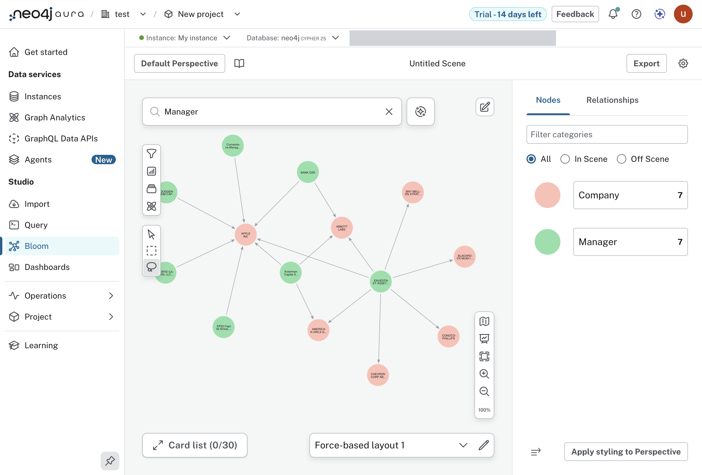
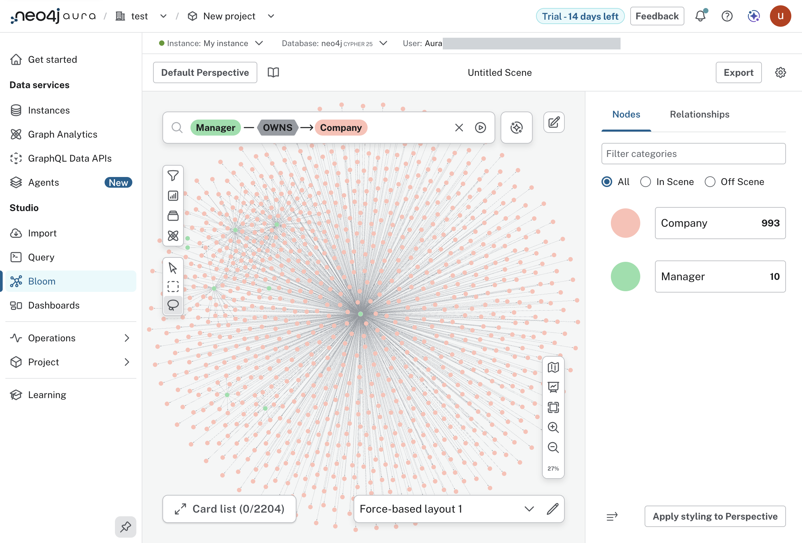
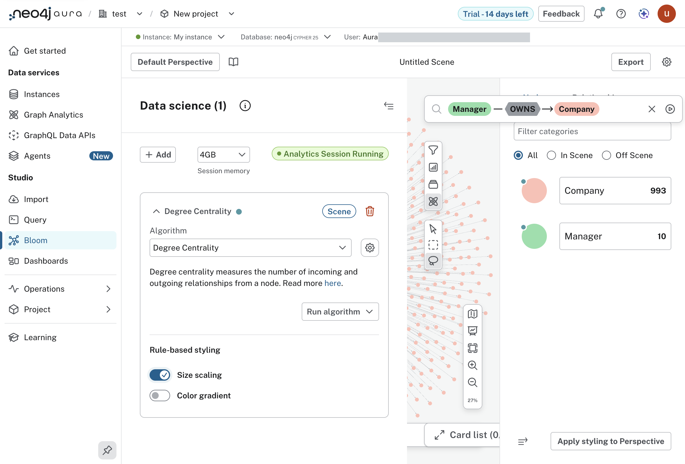
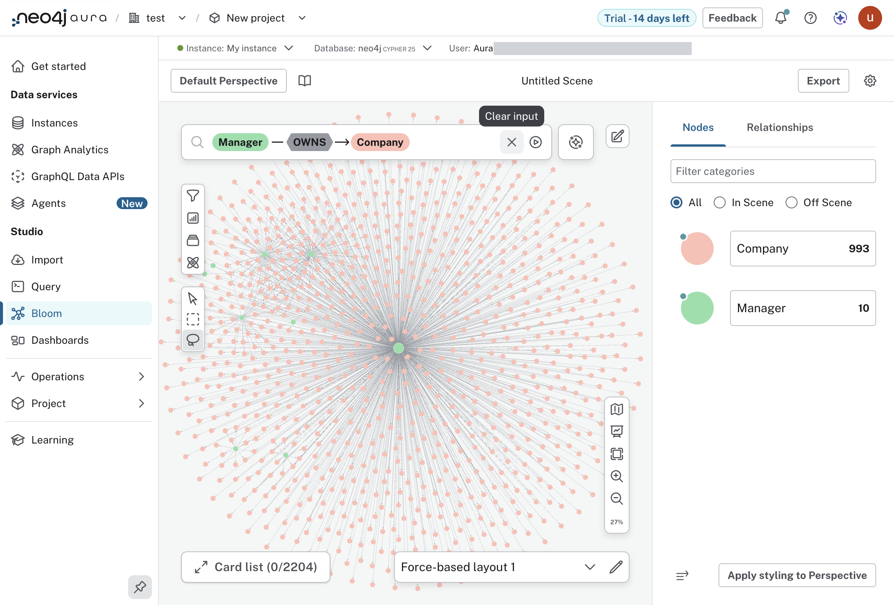

#+TITLE: Lab 5 - Bloom
#+DATE: 2026-10-08

From the lab text, =assignment-2-moving-data/lab-5-bloom= in the lab
repository. Driven in the console. The lab's step images are kept locally in
=resources/lab-05-bloom/= for reference and are not in the repository.

* The path

1. Bloom, from the sidebar under Studio (the lab says "Tools").
2. "Show me a graph": a scene of seven managers and seven companies.
3. Click the search bar. A list opens with a pill for each label. Click
   =Manager=, then =OWNS= in the list that follows, then =Company=, then
   press return.
4. The atom icon opens "Data science". "+ Add", then the algorithm
   drop-down, "Degree Centrality", "Run algorithm", "Apply to current scene".
5. When the session is running, switch on "Size scaling" under "Rule-based
   styling", and close the panel with the icon at its top right.

* Results

"Show me a graph".

The search. From the lab text it stops at a limit of 1,000; the scene held
993 companies and 10 managers, 2,204 cards in the list.

Degree Centrality run on the scene, size scaling on. The session is 4GB.

The scene with nodes sized by degree. The manager in the middle of the fan
is the largest.

* Where it left the lab's text

- The lab says the Graph Analytics session "takes a few minutes". It was
  running within about half a minute of "Apply to current scene".
- "Run algorithm" offers two choices: "Apply to current scene", which the
  lab takes, and "Create projection on the entire graph".
- "Size scaling" is a switch. Clicking its label does nothing; the switch
  itself has to be clicked.
- The first attempt at this lab failed at the search and was written up as
  Bloom not taking driven input. That was wrong: the clicks were landing
  above the search bar (finding 17).

From the lab text, Degree Centrality "spins up an additional ephemeral
instance running Neo4j Graph Analytics". That matches what the database
says for itself: =gds.version()= fails with "Aura Graph Analytics is
versionless" (finding 21). The session was left running when the lab ended;
whether a trial is charged for it is not something this session can see.

* Not in the lab: degree without Bloom

Degree is a count, so the file and plain Cypher both give it, over the whole
graph and not a scene of 1,000 paths. =bb form13 degree=, or the Lab 5 block
in =dev/explore.clj=.

| most companies held            | companies |
|--------------------------------+-----------|
| ENVESTNET ASSET MANAGEMENT INC |      1615 |
| GUGGENHEIM CAPITAL LLC         |      1318 |
| NOMURA ASSET MANAGEMENT CO LTD |      1019 |
| M&T Bank Corp                  |       972 |

| held by most managers | managers |
|-----------------------+----------|
| APPLE INC             |       22 |
| MICROSOFT CORP        |       21 |
| JOHNSON & JOHNSON     |       21 |
| DISNEY WALT CO        |       20 |
| JPMORGAN CHASE & CO   |       20 |

The lab mentions "communities of managers who have similar holdings".
Counting shared companies per pair of managers, Envestnet and Guggenheim
share 1,099.
