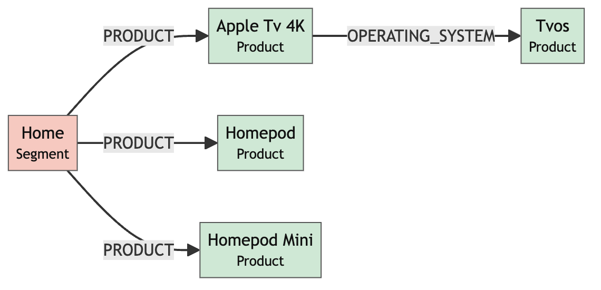
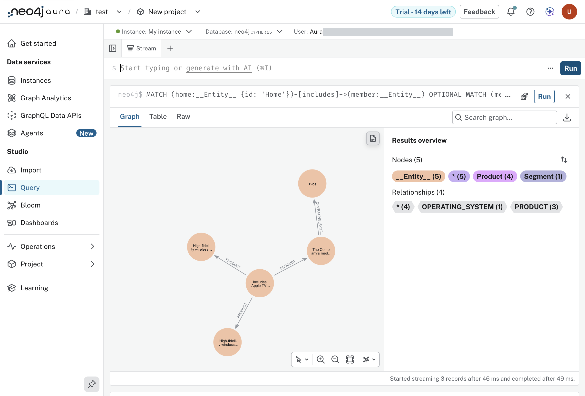

#+TITLE: Lab 6 - Document Intelligence
#+DATE: 2026-10-08

From the lab text, =assignment-3-ai-and-agents/lab-6-document-intelligence=
in the lab repository. Not done: the box in =README.org= is unticked.

* What the lab does

From the lab text: Document Intelligence is a tool in Aura, in private
preview, that turns documents into a knowledge graph. The lab uploads two
pages of Apple's 2025 10-K, asks for a graph model with the prompt "Extract
products, services, segments and competition.", and looks at the model and a
graph preview. The lab places it after two earlier approaches: LangChain
pipelines, and Neo4j Labs' LLM Graph Builder.

* Why it was not done

The lab starts from "Document Intelligence" in Aura's left menu. This
account's menu does not have it.

| what                       | the lab's images          | this account            |
|----------------------------+---------------------------+-------------------------|
| organization               | Vocareum                  | test                    |
| project                    | GCP marketplace project   | New project             |
| billing shown              | monthly usage, in dollars | "Trial - 14 days left"  |
| menu under Tools / Studio  | ends with Document Intelligence | ends with Dashboards |
| =.../tools/document-intelligence= | the tool           | redirects to Instances  |
| Import, "New data source", "Try it now" | not in the lab | redirects to Instances  |

The last row is the product's own way in. Import's "New data source" dialog
carries a banner, "Easily create knowledge graphs from unstructured data
like PDF, TXT, and other file formats with Document Intelligence", with a
"Try it now" button. The banner shows for this account; the button lands on
Instances, the same as the direct path. The dialog's own local option takes
.CSV and .TSV only.

From the lab text, the preview was "enabled for your account". The
comparison says it is enabled for the marketplace organization, and that
the sign-up in Lab 2 made a separate trial organization instead of joining
it (findings 13 and 22). That is a reading of the differences above; nobody
from the workshop has confirmed it.

What would fix it, untried: going through "Manage on provider" from the
Cloud console again and landing in the marketplace organization, or asking
the instructor to enable the preview for this one. Either may mean a second
instance and repeating Lab 4's load.

* Done another way

The lab's result was reproduced with the tool the lab names as Document
Intelligence's predecessor, the LLM Graph Builder, driven through its API
from Clojure: =experiments/005-graph-builder-api/=, with the seven attempts
it took. The same PDF and the same prompt gave 71 entities (117 after a
second run from the text, held to relationship triples), and the Home
category includes the HomePod, the HomePod mini and Apple TV 4K, which is
the observation the lab ends on.

It is a substitute. The box in =README.org= stays unticked: Document
Intelligence itself was never opened.

** The picture the lab ends on

From the lab text: "We can see the node for the home category includes
streaming and wireless devices such as the HomePod, HomePod mini and Apple
TV." The lab's own image of that is kept locally as
=resources/lab-06-document-intelligence/15.png=. Ours, two ways.

Drawn from the query's rows by =workshop.diagram=, as
[[file:diagrams/lab-06-home-category.mmd][diagrams/lab-06-home-category.mmd]]:

The same subgraph in the console's Query tool,
=labs/lab-06/05-home-graph.cypher=:

The console captions each node with its description and not its name: the
middle node, "Includes Apple TV…", is Home; the two "High-fidelity
wireless…" are the HomePod and the HomePod mini; "The Company's med…" is
Apple TV 4K, joined to tvOS.

Beside the lab's image: there, Home reaches the three products through two
category nodes, media streaming and high-fidelity wireless, by
INCLUDES_CATEGORY and IS_A_TYPE_OF. Here the same two phrases are in the
products' descriptions and Home points at the products directly with a
relationship named PRODUCT. Same reading of the same two pages, a different
model of it: Document Intelligence proposed a schema, and here the labels
were handed over and the relationship types left to the model.

* What is ready

The PDF, with a real file target so it is fetched once:

#+begin_src sh
gmake data/Apple_10-K_2025_2_pages.pdf
#+end_src

The browser saves it as =hands-on-lab_Apple_10-K_2025_2_pages.pdf=, which
is the name the lab's file picker step shows.
