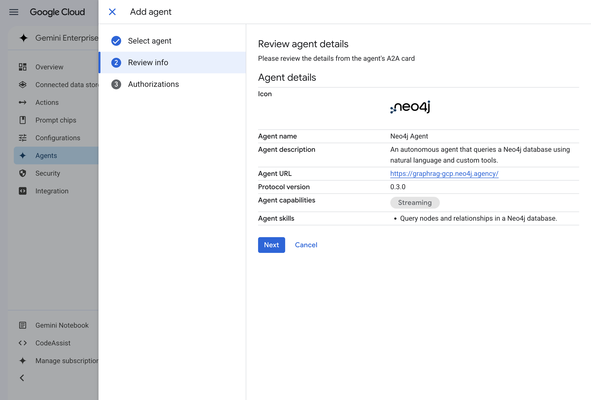
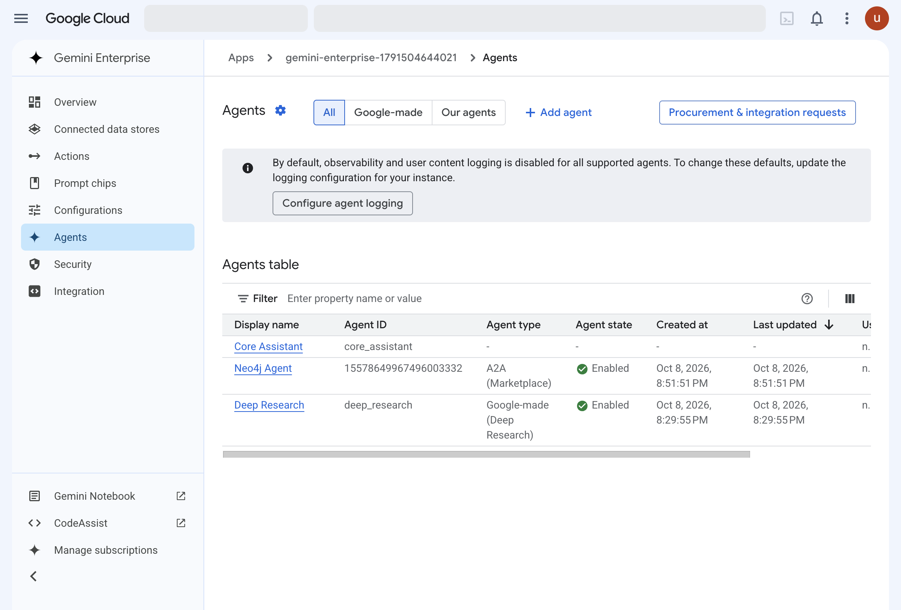
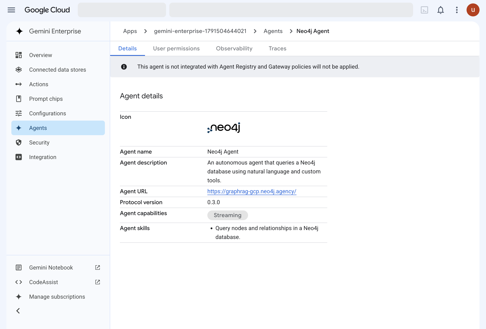

#+TITLE: Lab 7 - Deploy Neo4j Agent
#+DATE: 2026-10-08

From the lab text, =assignment-3-ai-and-agents/lab-7-deploy-neo4j-agent= in
the lab repository. Driven in the Google Cloud console as the lab account.
The lab's step images are kept locally in =resources/lab-07-deploy-neo4j-agent/=.

* The path

1. Marketplace, the "Neo4j Agent" listing, then "go to Gemini Enterprise".
2. "Start 30-day free trial", then "Continue and activate the API". This
   took about two minutes.
3. "Create". The app is made; the first load of its page said "Failed to
   load" and Retry worked.
4. "Agents" on the left, "Add agent". A panel offers five ways to add one;
   the tile wanted is "Agents via Marketplace".
5. Select "Neo4j Agent by Neo4j", "Next", "Next", "Finish". The last step
   sat on "Loading" for about ten seconds and ended with "Your agent was
   created successfully."
6. Reload. The agent is in the table.

* Results

Step two of the wizard, the agent's A2A card: agent URL
=https://graphrag-gcp.neo4j.agency/=, protocol version 0.3.0, capability
"Streaming", one skill, "Query nodes and relationships in a Neo4j database."

The check. The row reads Neo4j Agent, A2A (Marketplace), Enabled, which is
what the lab's last image shows.

The blue "Neo4j Agent" link.

* Where it left the lab's text

- The third wizard step, "Authorizations", has OAuth fields (authorization
  URL, token URL, scopes). The lab says only "Click Finish", and Finish with
  them untouched is right: the authorization comes later, on the first
  prompt in Lab 8.
- The table did not show the new agent until the page was reloaded, as the
  lab warns.

* By code

Nothing. =bb labs= reports this lab as blocked: adding a marketplace agent
has no documented API, and the console needs the lab account's sign-in. What
can be kept is the agent card above, which is all the configuration there is.
