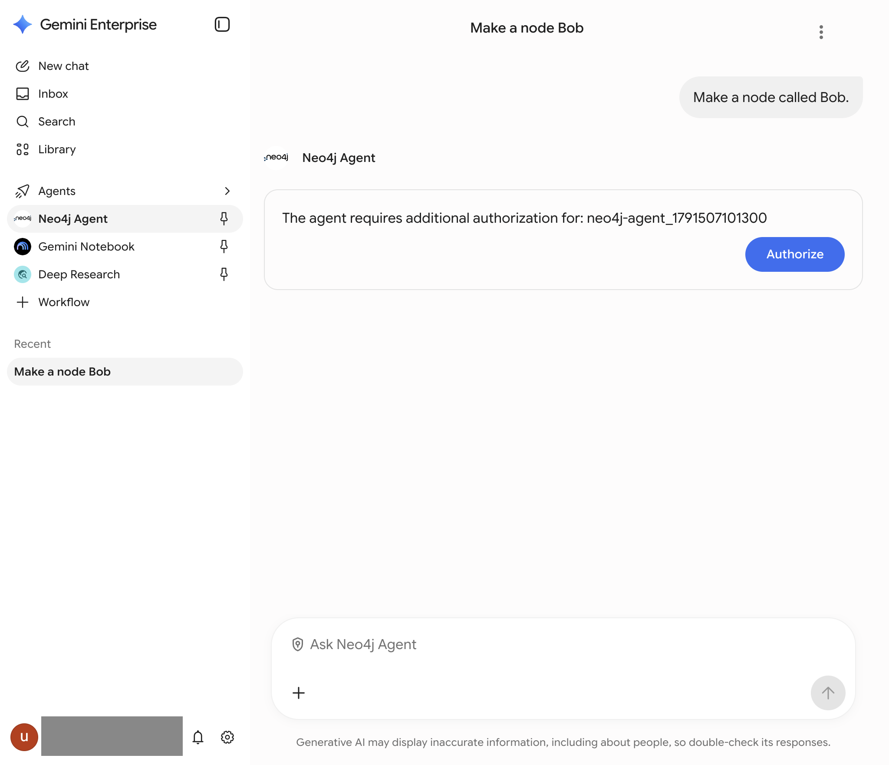
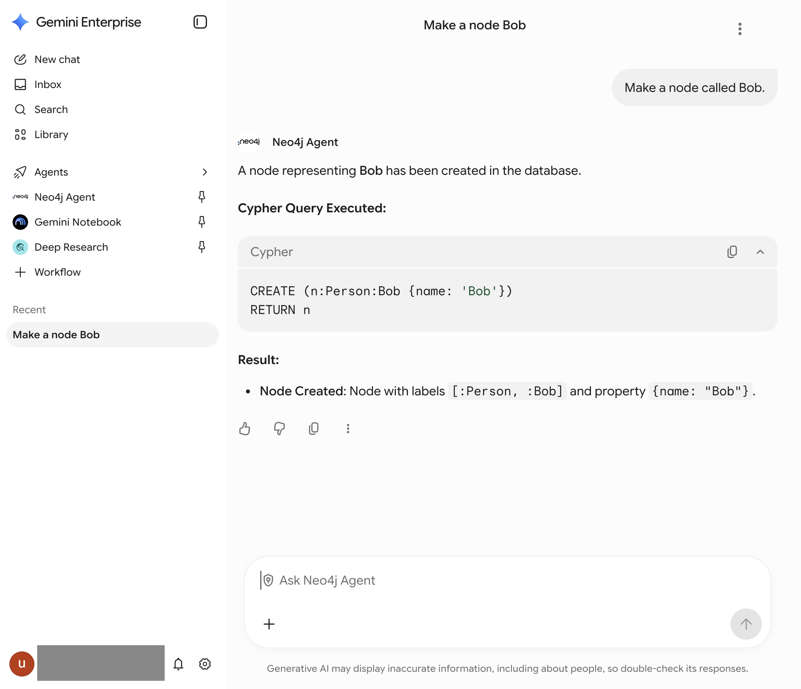
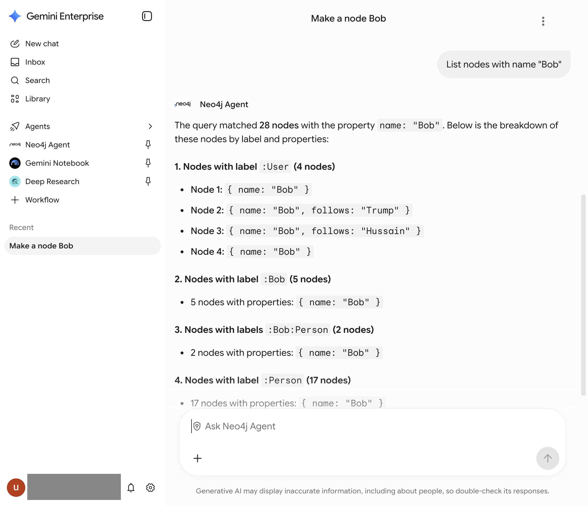
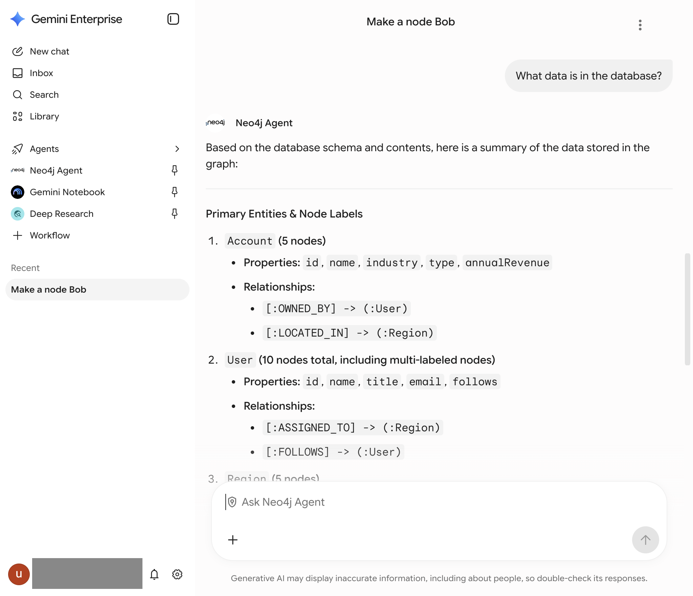

#+TITLE: Lab 8 - Use Neo4j Agent
#+DATE: 2026-10-08

From the lab text, =assignment-3-ai-and-agents/lab-8-use-neo4j-agent=. Driven
in the Gemini Enterprise preview. The three prompts are
=prompts/lab-08-01..03=; the answers, as text, are in
=examples/lab-08-conversation.txt=.

* The path

1. "Overview", then "Open preview" at the top right. It opens a new tab on
   =vertexaisearch.cloud.google.com=.
2. "Agents". The Neo4j Agent is under "From your organization". Its three
   dots give "Pin" and "Info"; Pin puts it in the sidebar.
3. Open the agent and send the first prompt. The answer is a card: "The
   agent requires additional authorization", with "Authorize". That opens a
   Google sign-in tab for the lab account, which closes itself, and the
   prompt then runs.

* Results

The lazy authorization the lab describes: nothing asks until a prompt is sent.

"Make a node called Bob." The agent shows the statement it ran:
=CREATE (n:Person:Bob {name: 'Bob'}) RETURN n=. Two labels, one of them the
name.

'List nodes with name "Bob"'. 28 nodes: 4 =:User=, 5 =:Bob=, 2 =:Bob:Person=,
17 =:Person=.

"What data is in the database?" Accounts (5), Users (10), Regions (5),
OWNED_BY, LOCATED_IN, ASSIGNED_TO, FOLLOWS, and a tail of labels other
attendees made: Bob, Bobby, Cat, Js, Tanya, Biden, BABU, I_was_here_Oct_7.

* Where it left the lab's text

- The lab says a second Bob "will just overwrite the existing node". It does
  not. The agent ran CREATE, not MERGE, and the database holds 28 Bobs.
- The lab says the shared instance "has the SEC data from the earlier query
  loaded into it". The agent's own description of it has no Manager, Company
  or OWNS: it is a small CRM-shaped sample (Account, User, Region).
- The label the agent chose differs by attendee (=:Person=, =:Bob=,
  =:Bob:Person=, =:User=): the same prompt, four schemas.
- This is the instructor's shared instance, not ours. Nothing in this
  repository's tooling can reach it; the only way in is the agent.

* By code

Nothing, for the same reason as Lab 7, plus an OAuth consent in a browser.
The transport is worth writing down: Gemini Enterprise speaks A2A to
=graphrag-gcp.neo4j.agency=, which from the lab text is the Neo4j MCP server
in a hosted wrapper.
