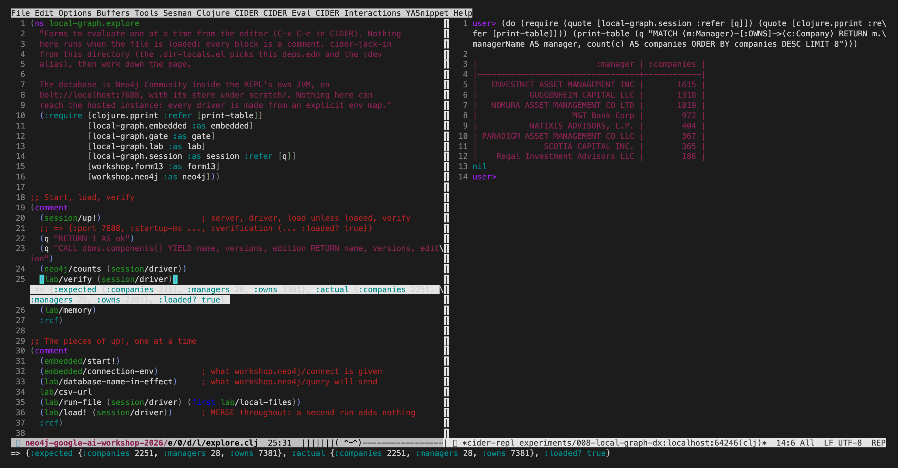
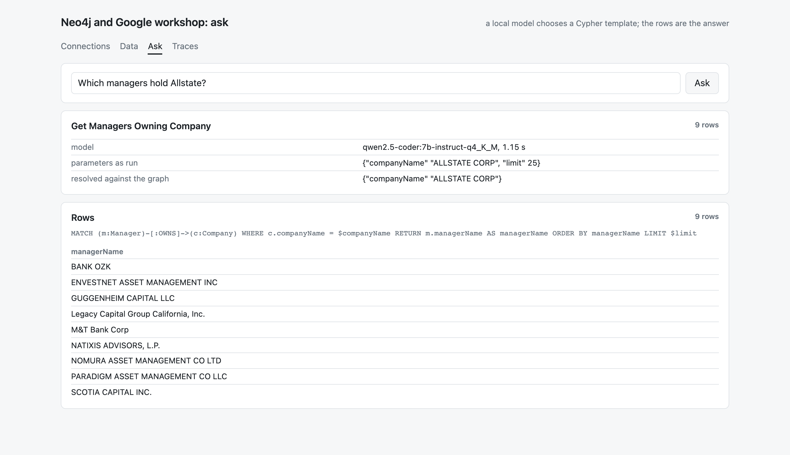
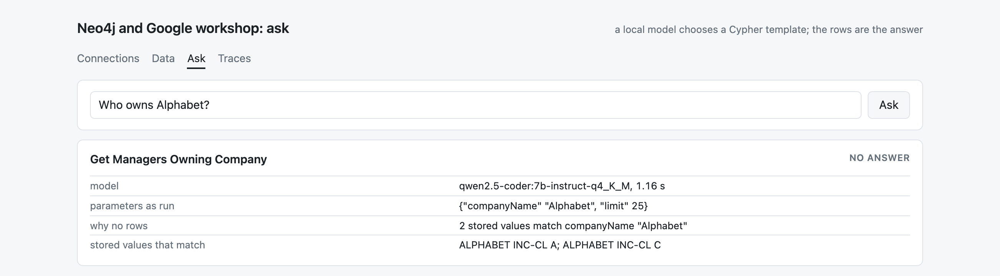
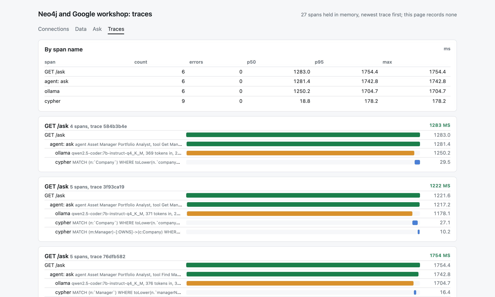

#+TITLE: The lab, local first
#+DATE: 2026-10-09

Ours, written the day after. The workshop's nine labs need two cloud
consoles and an account that lasts five hours. This is the same path with
nothing hosted: a Neo4j inside a JVM on this machine, a small model served
by Ollama, and a REPL. What cannot be done locally is said, not papered over.

* What you need

- A JVM, =clojure= and =bb=. Nothing else is installed.
- Ollama, for the two steps that use a model. The default is this machine
  and =llama3.2:3b=. A machine with no room for a model points at one that
  has it: =OLLAMA_URL=http://other-host:11434=, and =OLLAMA_MODEL= to choose
  the model. Both are read from the environment or the env file.
- =WORKSHOP_ENV=local-graph.env= on every command, so that nothing reads the
  hosted instance's =.env=.

* The path

| lab | hosted                                   | local                                                           | status              |
|-----+------------------------------------------+-----------------------------------------------------------------+---------------------|
| 1-2 | sign in, deploy Aura                     | =bb local=: embedded Neo4j on =bolt://localhost:7688=           | works               |
|   3 | connect, =SHOW DATABASES=                | =bb ping=, =bb databases=                                       | works               |
|   4 | keyed load of the Form 13 day file       | =bb local= loads it and checks it against the file              | works, one change   |
|   5 | Bloom, degree centrality                 | =bb form13 degree=; the dashboard's =/data= page                | numbers, no picture |
|   6 | a 10-K into a graph                      | =workshop.extract=: a local model held to a JSON schema         | gate not passed     |
| 7-8 | a hosted agent over a shared database    | nothing: it is somebody else's service                          | not applicable      |
|   9 | an agent generated from a prompt         | =bb ask=, =/ask=: a local model chooses one of that agent's templates | works         |
|   - | (no lab)                                 | =/traces=: what every statement, check and model call cost      | works               |

The one change in Lab 4: =IS NODE KEY= is Enterprise only, so the local
constraint is =IS UNIQUE= (=experiments/008-local-graph-dx=).

* In a shell

#+begin_src sh
bb local                                   # leave running; ctrl-c stops it
export WORKSHOP_ENV=local-graph.env
bb counts
bb form13 verify
bb ask Which managers hold Allstate
bb dashboard                               # / /data /ask /traces on 127.0.0.1:8377
#+end_src

* In a REPL

=cider-jack-in= in =experiments/008-local-graph-dx=, then
=dev/local_graph/explore.clj= a form at a time. The server lives in the
REPL's own JVM, so there is one process to start and one to stop.

#+begin_src clojure
(session/up!)                                  ; server, driver, load, verify
(q "MATCH (m:Manager) RETURN count(m)")
(require '[workshop.agent :as agent] '[workshop.telemetry :as telemetry])
(agent/ask (session/driver) "Which companies does Guggenheim own?")
(telemetry/summary)
#+end_src

* The agent

"Which managers hold Allstate?" The model named the tool and wrote
"Allstate"; the graph supplied "ALLSTATE CORP"; the template returned nine
managers. Lab 9's hosted agent answered three for the same company
(finding 26).

A name that matches two stored values gets the two values and no rows.

The same requests as traces: orange is the model, blue is Cypher.

What it is and is not: the model chooses among templates somebody wrote and
fills in their arguments. It writes no Cypher and no sentences. Measured on
twelve questions, a 7B model got eleven right and none wrong; a 3B model
nine, with three refusals and none wrong (=experiments/009-local-agent=).

* What is not local

- Bloom and Graph Analytics. Degree is a count; nothing here draws the scene
  or runs an algorithm in a session.
- Labs 7 and 8. A marketplace agent inside Gemini Enterprise has no local
  form, and the database behind it was never ours.
- Lab 6 does not yet work. The schema makes a small model's output
  well-formed and no more (=experiments/006-structured-extraction=).
- Node keys and existence constraints, which are Enterprise.
- Generating the agent from a paragraph. The local agent starts from the
  export Lab 9 produced.

* Not checked

- =bb local= as one command. Its two halves, the gate and the server, were
  each run on their own; today the server was already up inside a REPL,
  which holds the store, so the task itself was not started.
- Anything with the model on this machine. Every model call here went to
  another host through =OLLAMA_URL=; the default of this machine and
  =llama3.2:3b= is what the code does when nothing is set, and it was not
  exercised.

* Other data

Nothing in =workshop.agent=, =workshop.ollama=, =workshop.telemetry= or the
dashboard's =/ask= and =/traces= names this dataset. =/data= and
=workshop.form13= do. What a second dataset needs is in
=notes/review-framework-2026-10-08.org=, and fifteen candidates are in
=notes/data-sources.org=.

One second dataset exists: a reading list. =bb papers fetch= keeps the arXiv
papers a =.bib= names in =$XDG_CACHE_HOME/workshop-papers=, outside the
repository, so worktrees and agents share one copy and a container mounts
one directory. =workshop.papers= makes Paper, Author, WROTE and CITES from
it with no model and loads them beside the Form 13 graph: 80 papers from
two reading lists and 165 citations among them, asked about in
=labs/papers/01-questions.cypher=. The model's layer
on top did not pass its gate (=experiments/010-papers-dataset=).

#+begin_src sh
bb papers where        # the cache and the .bib in use
bb papers fetch        # once; again is a no-op
PAPERS_BIB=other.bib bb papers list
bb papers add ~/some/directory-of-pdfs   # <arxiv-id>-name.pdf, a subdirectory is a category
bb papers index        # everything cached, from every collection
#+end_src
