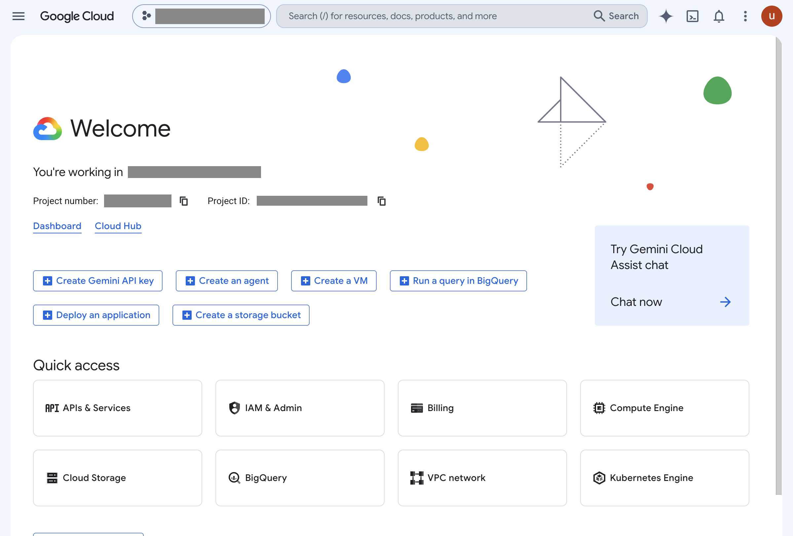
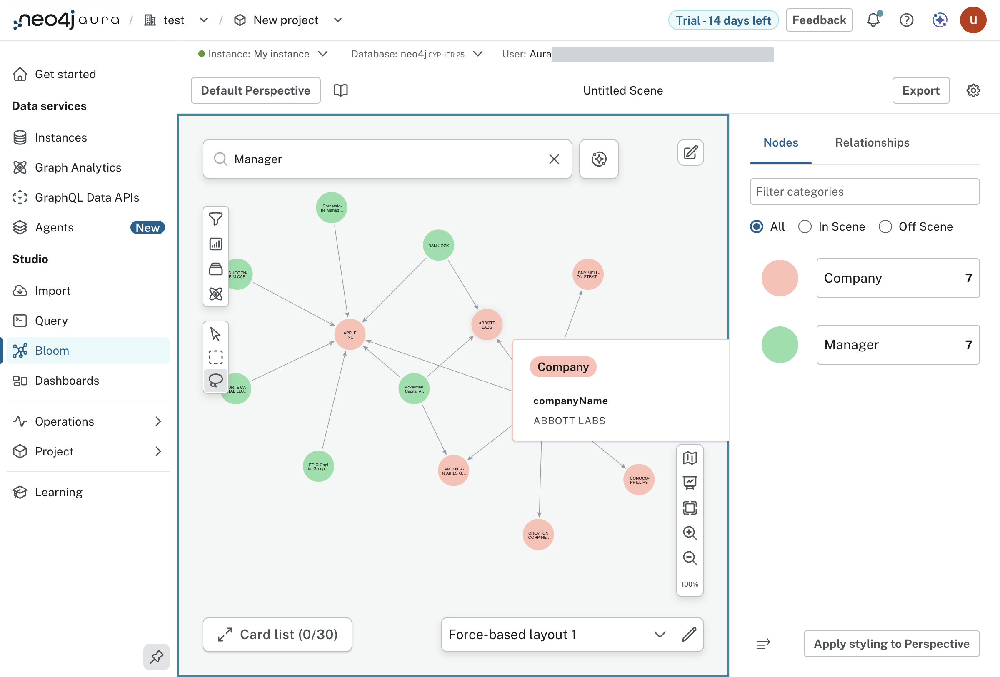
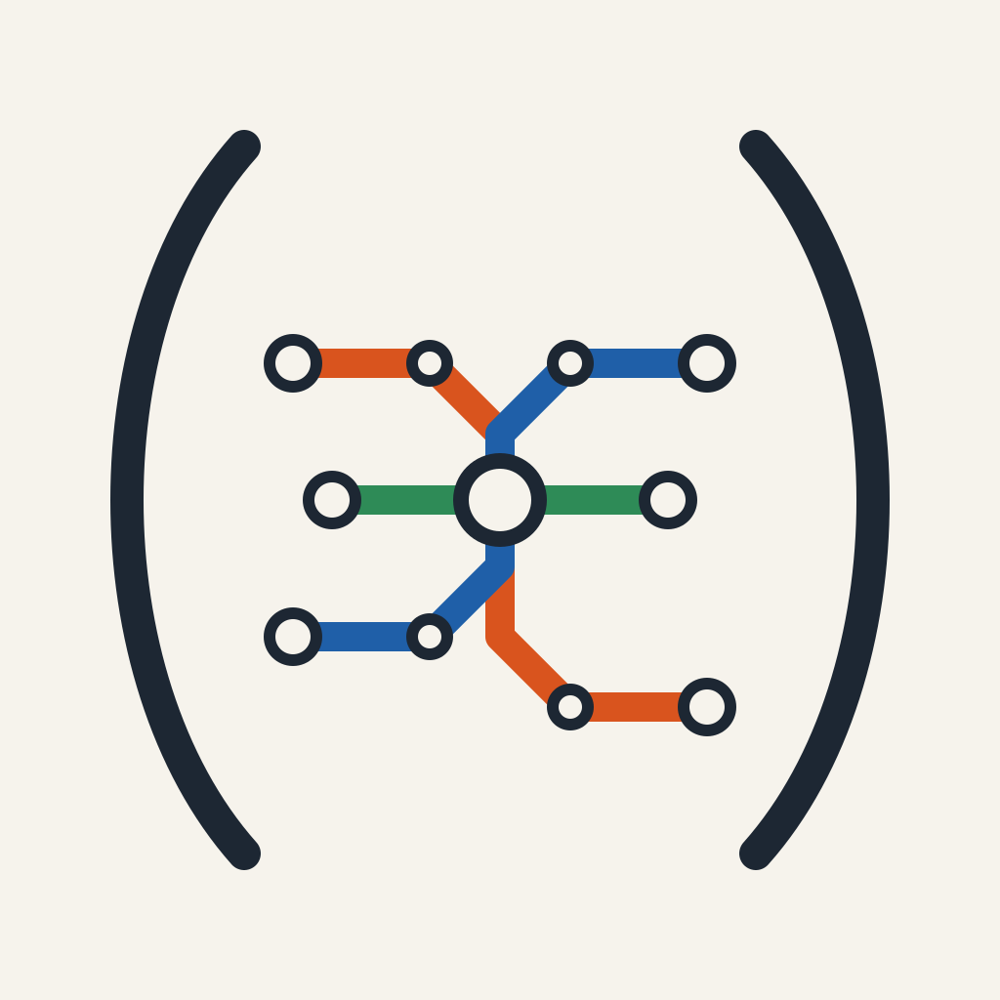
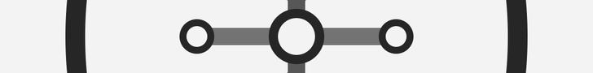
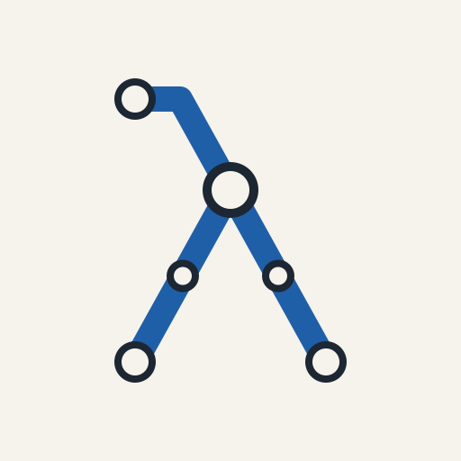

#+TITLE: Screens
#+DATE: 2026-10-08

What the consoles looked like, kept because the lab account, the project and
the instance are gone a few hours after the workshop. Each image went through
=bb redact= and was looked at before it was added. Screens that belong to one
lab are in that lab's note; these are the ones that belong to none.

* 19:08, between Lab 4 and Lab 5

The Cloud console on the lab project. Nothing has been created in it: every
lab so far ran in Aura.

Bloom after "Show me a graph", with one company selected.

[[file:img/state-dashboard.png]]

=bb dashboard=, retaken ten minutes before the instance expired: both
graphs in the instance, each lab's status, the lab browser's tabs.

* Not captured

- Lab 6 as written: this account had no Document Intelligence. Its stand-in
  and Labs 7 to 9 have their images in their own notes.
- Emacs against Aura. The one session below is on the local graph.

* Emacs and CIDER on the local graph

[[file:img/emacs-cider-local-graph.png]]

Taken after the lab account expired, so the database is the embedded Neo4j
of =experiments/008-local-graph-dx=, not Aura. Left, =dev/local_graph/explore.clj=
with =(lab/verify (session/driver))= evaluated in place: the load holds what
the file says, 2,251 companies, 28 managers, 7,381 OWNS. Right, the CIDER
REPL with a Cypher statement run through =q= and printed as a table.

How it was made: =clojure -M:dev:repl= in one tmux window, =emacs -nw= in
another, =cider-connect-clj= to the port in =.nrepl-port=, and the forms
evaluated by keys sent to the pane. The picture is that pane's text and
colour codes rendered to an image, so the palette is approximate and the
font is not the terminal's. The session is real; a person at the keyboard
was not.

* The card

Ours, 2026-10-10. A small transit map held in a pair of parentheses: three
lines meeting at one interchange, for a graph asked about from a Lisp. It
is the image at the top of the README (the 256 pixel
[[file:img/workshop-thumbnail.png][thumbnail]]) and the logo of the sign-in
application; a grey  is cut
from the same picture.

It is drawn from data, not by hand. =bb/card.clj= holds each line as a
colour and the points it runs through and each station as a place and a
kind, and writes =notes/diagrams/workshop-card.svg= from them. To change the
picture, change those values:

#+begin_src sh
bb card        # the SVG, from bb/card.clj
gmake card     # the SVG and the three PNGs, each only if its source changed
#+end_src

It needs babashka, and =rsvg-convert= (librsvg) or ImageMagick to turn the
SVG into a PNG; ImageMagick's =magick= makes the thumbnail and the strip.
The three sizes are the ones the owner's site uses for a note's card,
thumbnail and banner.

The lines are made up. Drawing them from the transit graph, so that the
card is the real map, is the next step and is not done: =svg= already takes
lines and stations as arguments, and what is missing is a layout that turns
stations' coordinates into a diagram of straight runs.

** Two others, kept

Drawn the same day as alternatives and kept beside the card. Both are SVG
written by hand, in =notes/diagrams/=, and are not made by =bb card=.

A prompt and the graph it answers with, on a dark rounded square. It is
the one that reads best at the size of an application's icon.

One line of a map bent into a lambda, with its stops.

