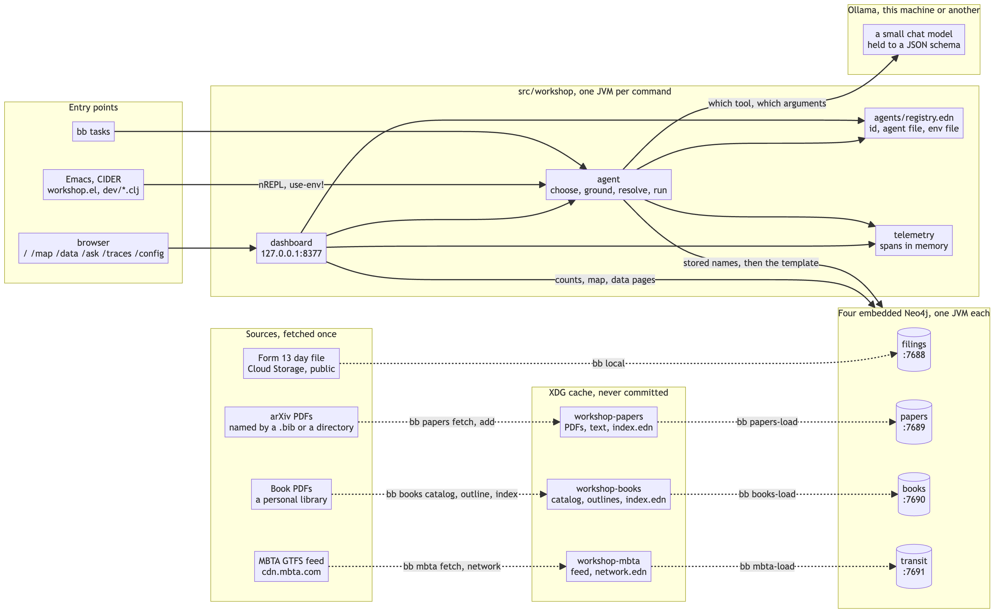

#+TITLE: The system as built
#+DATE: 2026-10-09

Ours. [[file:architecture.org][architecture.org]] is the workshop's architecture, read from its
slides: Google Cloud, Aura, Gemini Enterprise. This is what the repository
runs on one machine in its place, as of 2026-10-09. The diagram is
[[file:diagrams/local-system.mmd][diagrams/local-system.mmd]].

* The idea in one paragraph

Each data source gets its own Neo4j, embedded in a JVM, on its own port. An
agent is a JSON file of named Cypher templates over one of those graphs. A
question goes to a small local model that is asked only which template and
with which arguments; the template runs as written and its rows are the
answer. A registry ties agent, graph and example together, and everything
else (the commands, the dashboard, the Emacs commands) reads the registry.
Adding a source is a loader, an env file, an agent file and a registry
entry.

* What runs

| process            | started by        | listens on           | holds                                      |
|--------------------+-------------------+----------------------+--------------------------------------------|
| Neo4j, filings     | =bb local=        | bolt 7688            | Lab 4's Form 13 day file                   |
| Neo4j, papers      | =bb local-papers= | bolt 7689            | 80 arXiv papers and their citations        |
| Neo4j, books       | =bb local-books=  | bolt 7690            | 29 books: headings, terms, index concepts  |
| Neo4j, transit     | =bb local-mbta=   | bolt 7691            | the MBTA's rail network from its GTFS feed |
| dashboard          | =bb dashboard=    | http 127.0.0.1:8377  | nothing; it reads the four graphs          |
| nREPL              | =bb repl=, CIDER  | a port in .nrepl-port | one driver, switched by =use-env!=        |
| Ollama             | outside the repo  | http 11434           | the models                                 |

The servers are Neo4j Community, embedded
(=experiments/008-local-graph-dx=): one store directory and one JVM per
source, so a source can be dropped and rebuilt without touching another.
Community has one database per server, which is why there are four servers
and not four databases. Every =bb= task is its own short-lived JVM;
babashka is the runner, the drivers are JVM libraries.

* Which graph a command talks to

One env file per graph, tracked, holding only a local address:
=local-graph.env=, =papers-graph.env=, =books-graph.env=,
=mbta-graph.env=. =WORKSHOP_ENV= names the one a command uses; without it
the command reads =.env=, the hosted lab instance. In a REPL,
=(use-env! "books-graph.env")= closes the session's driver and opens the
next. The agents do not use either: =agents/registry.edn= names each
agent's env file, and =agent/ask-agent= opens a driver for the one
question.

* From a source to a graph

Dotted arrows in the diagram. Each is done once, by hand, and can be done
again.

| source  | fetch and read                               | kept in                    | load              |
|---------+----------------------------------------------+----------------------------+-------------------|
| filings | =gmake data/...= or the server's own start    | =data/=, git-ignored       | =bb local=        |
| papers  | =bb papers fetch=, =add DIR=                  | =~/.cache/workshop-papers= | =bb papers-load=  |
| books   | =bb books catalog=, =fetch=, =outline=, =index= | =~/.cache/workshop-books=  | =bb books-load=   |
| transit | =bb mbta fetch=, =network=                    | =~/.cache/workshop-mbta=   | =bb mbta-load=    |

The fetch and read steps run in babashka itself (=bb/=), with no JVM: they
are file work and =pdftotext=. Each writes one EDN file, and the loader in
=src/workshop/= reads only that file. So the graph can be rebuilt from the
cache with no network, and the repository holds the code that reads a
library and none of the library.

* The path of a question

=bb ask --agent mbta How do I get from Maverick to Kendall?=, or the same
on =/ask=.

1. =agent/entry= finds the agent in the registry: its JSON file and its
   env file. A driver is opened on that graph.
2. *First call to the model.* The system message lists the tools and what
   each is for. The answer is held to a JSON schema: a tool name from the
   agent's own list or "none", and an arguments object.
3. *Second call*, when the chosen tool lacks an argument it needs or the
   graph has a short list of values for one. The schema is that tool's
   arguments alone, the needed ones required, and a string the template
   compares with a property becomes an enum of the stored values when
   there are 400 or fewer (=agent/domains=). 254 stations make an enum;
   some thousands of company names do not.
4. =grounded=: an argument the question does not support is dropped. A
   string must appear in the question, a number must appear as a number,
   and a value picked from a list must share a word with the question.
5. =validate=: the tool exists and has what it needs, defaults filled in.
6. =resolve-value=: a name is matched against the graph. One match runs;
   none or several is shown as the reason there are no rows.
7. The template runs with those parameters. Its rows are the answer.

No prose is generated at any step. The two things a schema cannot rule
out, an invented value and a wrong choice of tool, are met differently:
the first by steps 4 and 6, the second not at all when the wrong tool's
arguments happen to be in the question (=experiments/009-local-agent=,
=experiments/013-laptop-models=).

* The model

One client, =workshop.ollama=, one endpoint, =/api/chat=, temperature 0,
thinking off, a JSON schema as the format. =OLLAMA_URL= and =OLLAMA_MODEL=
choose the host and the model; the default host is this machine. The model
is nearly all of a question's time: about a second of model against tens
of milliseconds of Cypher.

Measured on this work so far, 3B to 7B: =qwen2.5-coder= 7B, =qwen3:4b=,
=qwen2.5:3b=, =llama3.2= 3B, =mistral= 7B. Experiment 009 has the first
table and 013 the laptop's.

* What a person touches

- *Shell.* =bb tasks= lists the commands; =workshop.cli= is what they call.
- *Browser.* The dashboard on loopback only: =/= an overview of every
  source in the registry, =/map= the transit network drawn from station
  coordinates, =/data= the filings' questions, =/ask= the agents,
  =/traces= what each page cost, =/config= the connection checks.
- *Emacs.* =workshop.el=: =workshop-repl= lays a page of forms beside the
  REPL, =workshop-graph= switches graph. Each namespace ends in a
  =(comment ...)= block of forms to evaluate.

=workshop.telemetry= wraps every statement, check and model call in a
span, kept in memory; =/traces= draws them ([[file:telemetry.org][telemetry.org]]).

* What is where

| in the repository                               | outside it                                   |
|-------------------------------------------------+----------------------------------------------|
| code, agent files, the registry, env files with local addresses | =.env=: the hosted lab's credentials |
| notes, queries, prompts, experiments             | the caches: PDFs, catalog, outlines, the feed |
| question sets and results of experiments         | the Neo4j stores, under =experiments/008-.../scratch/= |
|                                                 | the models                                   |

* What it does not do

- No join across graphs. A question goes to one agent and one graph.
- No conversation. Each question stands alone.
- No writes from a question: every template is a read.
- No choice of agent by the model. The person picks the source.
- No times in transit: a journey's minutes are arithmetic on stops, changes
  and metres walked.
- Nothing is supervised. Four servers and a dashboard are started by hand,
  in a terminal each.

* Not yet built

Noted on 2026-10-09, none of it run: a decision model for step 2 in place
of a chat model, which returns a probability for each tool and so a
threshold for "none"; and a prompt searched for by an optimizer
(=experiments/014-dspy-mbta=, in progress).
