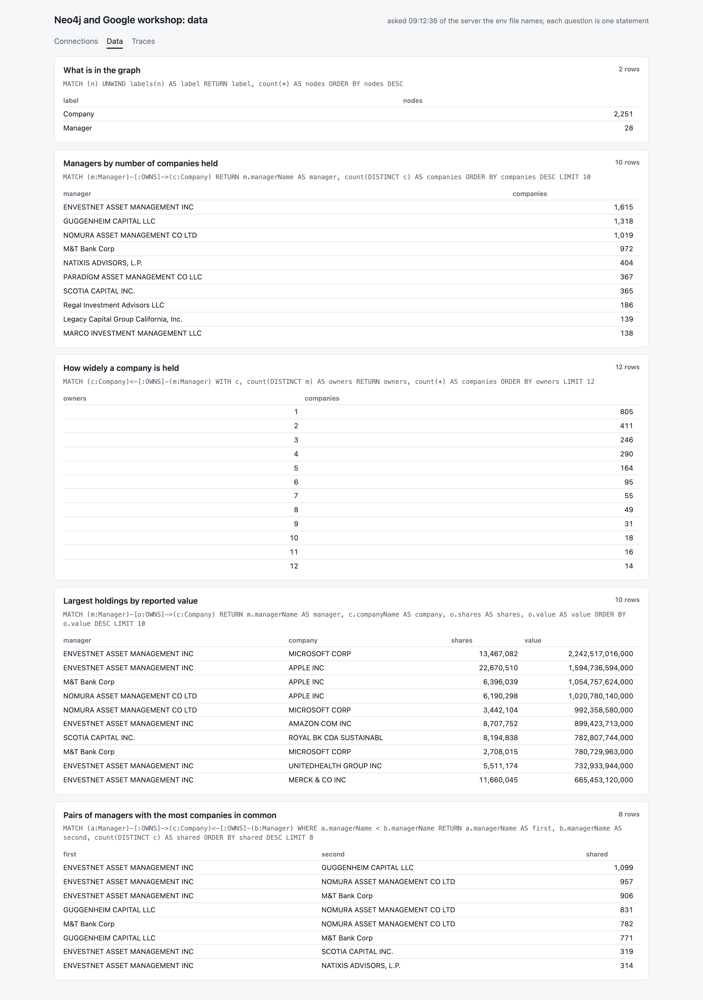
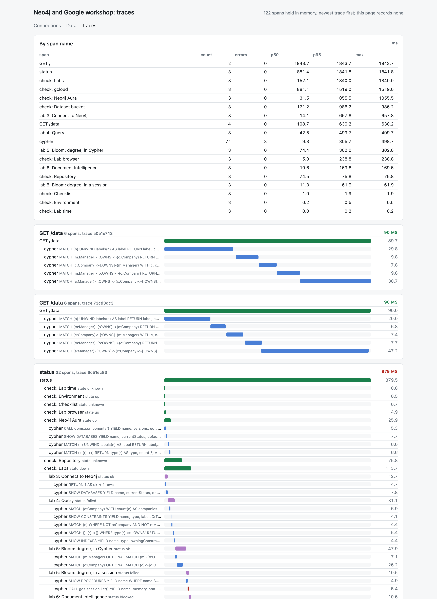

#+TITLE: Telemetry: spans from the tooling, and two more dashboard pages
#+DATE: 2026-10-09

Ours, not from the workshop, and made the morning after it: the lab account
had expired, so everything here ran against the embedded Neo4j of
=experiments/008-local-graph-dx=, which holds the same Form 13 day file.

* What it is

=workshop.telemetry= keeps spans in memory: a name, a start, a duration, a
parent, a few attributes. It is the shape OpenTelemetry uses, in about a
hundred lines and with no dependency; nothing leaves the process. The last
4,000 spans are held.

Three places open spans, so every command and every page gets them:

| span                  | where                     | attributes                                         |
|-----------------------+---------------------------+----------------------------------------------------|
| =cypher=              | =workshop.neo4j/query=    | the statement's first line, parameter names, rows  |
| =check: <name>=       | =workshop.status=         | the state the check reported                       |
| =lab N: <title>=      | =workshop.labs=           | the step's status                                  |

A statement's parameters are named, never valued, and no row is recorded.
The spans are real. Nothing here is mocked: the durations are what the
local server took.

* The pages

=bb dashboard= now serves three, on 127.0.0.1:8377 as before.

- =/= :: the connection checks. Each load is one trace.
- =/data= :: five questions of whatever graph the env file names, one
  statement each, printed above its rows.
- =/traces= :: the last twelve traces as waterfalls, and a table by span
  name with count, errors, p50, p95 and max. It records no spans itself.
  =/spans.edn= is the raw buffer.

=/data= on the local graph.

=/traces=. Blue is a Cypher statement, purple a lab step, green a check or a
request, red a failure.

* What the first traces showed

- The first load of =/= took 1,844 ms and the next 882 ms. The difference is
  the driver's first connection: the first statement alone took 499 ms and
  the same statement later took 5.
- Warm, the page is as slow as its slowest check, and that is =gcloud= at
  880 ms: two =gcloud config get-value= calls in a shell. Every Cypher
  statement on the page together is under 150 ms. The checks run side by
  side, so the status page costs one =gcloud=.
- Three spans failed, the same one each time: =CALL gds.session.list()=.
  The local server has no Graph Analytics, which is expected, and the step
  that calls it reports =failed= where on Aura it reported =skipped=.
- Lab 4's step is =failed= locally too, with no failed statement under it:
  it looks for node keys, and Community has only the uniqueness constraints
  (experiment 008 says why). The trace shows which of the two kinds of
  failure a red step is.

* From a REPL

#+begin_src clojure
(require '[workshop.telemetry :as telemetry])
(telemetry/span "my question" {} (q "MATCH (n) RETURN count(n)"))
(telemetry/summary)          ; per span name: count, errors, p50, p95, max
(telemetry/slowest 5 "cypher")
(telemetry/traces 3)
#+end_src

* Pointing the tooling somewhere else

=WORKSHOP_ENV= names a file to read in place of =.env=.
=WORKSHOP_ENV=local-graph.env bb dashboard= is how the pictures above were
made; =local-graph.env= is tracked and holds no secret.

* Not done

- No export. OTLP to a collector would be a function over =(telemetry/spans)=.
- No sampling and no persistence: restart the process and the buffer is empty.
- The Graph Builder and Ollama calls are not spans yet.
- Never run against Aura: the instance was gone before this existed.
