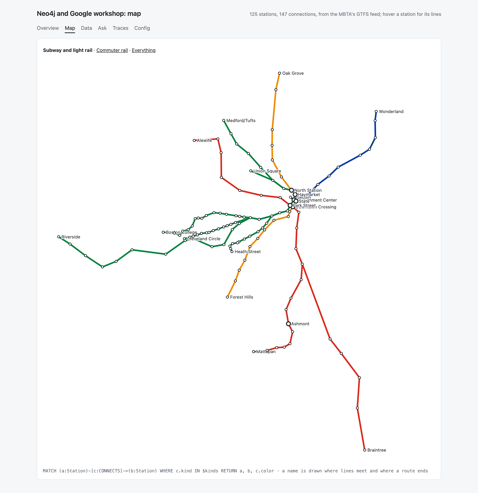
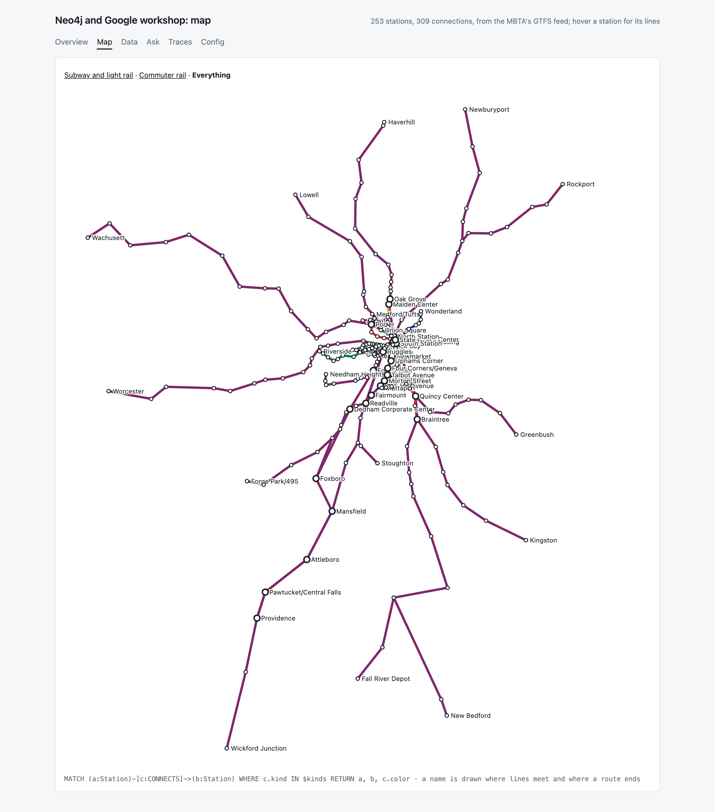
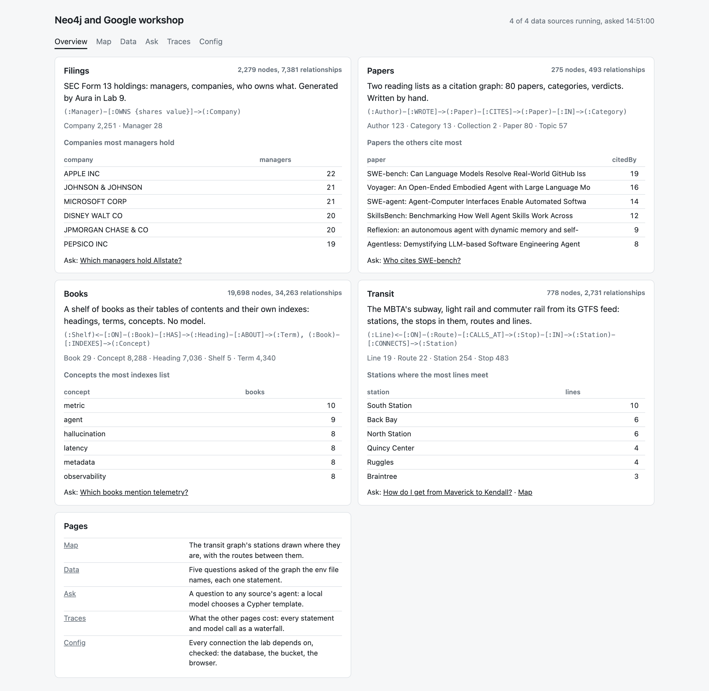

#+title: Transit: the MBTA's rail network as a graph, and a map from it
#+date: 2026-10-09

* Why this one

=notes/data-sources.org= listed the MBTA's GTFS feed as a source worth
pulling. It is public, it is Boston, and it is the first source here whose
nodes have a place: a station has a latitude and a longitude, so the graph
can be drawn where it is.

The feed is not committed. =bb mbta fetch= keeps it in the XDG cache
(=~/.cache/workshop-mbta=, 25 MB), and =bb mbta network= cuts it to the
subway, light rail and commuter rail: a few hundred kilobytes of EDN. The
feed read on 2026-10-09 calls itself "Fall 2026, version D". The MBTA's
terms for developers apply to it, not this repository's licence.

* Stations and stops, lines and routes

GTFS keeps two distinctions that a rider does not, and the graph keeps
them because they are where the questions differ.

- A /station/ (=location_type= 1) is a place with a name: Park Street. A
  /stop/ (=location_type= 0) is where a vehicle stops: one platform, for
  one direction. Each stop names its =parent_station=. Park Street is one
  station and ten stops.
- A /route/ is what a timetable is for: Green Line B. A /line/ groups
  routes: the Green Line is four of them.

#+begin_src text
(:Route)-[:ON]->(:Line)
(:Stop)-[:IN]->(:Station)
(:Route)-[:CALLS_AT {direction sequence}]->(:Stop)
(:Stop)-[:NEXT {route direction}]->(:Stop)
(:Route)-[:SERVES {sequence}]->(:Station)
(:Station)-[:CONNECTS {route routeName line kind color}]->(:Station)
#+end_src

=NEXT= is what the feed says: the order one typical trip of each pattern
calls at its stops. =SERVES= and =CONNECTS= are derived from it by replacing
each stop with its station, and are what a map or a journey asks. A
station also has a =location= point, with a point index, so distance is a
function in Cypher.

| What                        | Count |
|-----------------------------+-------|
| Lines                       | 19    |
| Routes                      | 22 (3 subway, 5 light rail, 14 commuter rail) |
| Stations                    | 254   |
| Stops                       | 483   |
| NEXT, between stops         | 622   |
| CONNECTS, between stations  | 616   |

A fourth embedded Neo4j holds it, on =localhost:7691=:

#+begin_src sh
bb mbta network      # fetch the feed if need be, write network.edn (about a minute)
bb local-mbta        # the server, until ctrl-c
bb mbta-load         # MERGE it in; twice leaves the same graph
#+end_src

* The map

=/map= on the dashboard. One statement asks for every pair of connected
stations with the route's own colour from the feed, another for the
stations with how many lines meet at each; the page turns latitude and
longitude into x and y and writes SVG. No tiles, no script, no outside
service. A name is drawn where lines meet and where a route ends; the rest
are on hover. Three views: subway and light rail, commuter rail, all of it.

All of it. The first drawing of this view was wrong, and showed it: the
Newburyport/Rockport line zigzagged between its two branches and a fan of
straight lines ran to Providence. A route with branches has one typical
trip for each, and their stops had been put in one order by sequence
number. The trip is now kept with each call, and stops follow one another
only within a trip. The picture found a fault in the graph that a count
would not have: 699 =NEXT= edges looked as plausible as 622.

Query and Bloom would not have drawn this. They lay a graph out by force,
and the Red Line comes out as a tangle. The coordinates are in the graph;
placing nodes by them is the page's job.

* The agent, and Maverick to Kendall

=agents/mbta.agent.json= has six templates: the routes at a station, the
stations on a route in order, a subway journey between two stations, the
stations near a station, the platforms in a station, the stations in a
municipality.

The owner's example: from Maverick, on the Blue Line, to Kendall, on the
Red. The two lines do not meet. =shortestPath= over =CONNECTS=, with commuter
rail left out, gives:

| Step | From              | To                | Line        |
|------+-------------------+-------------------+-------------|
|    1 | Maverick          | Aquarium          | Blue Line   |
|    2 | Aquarium          | State             | Blue Line   |
|    3 | State             | Government Center | Blue Line   |
|    4 | Government Center | Park Street       | Green Line  |
|    5 | Park Street       | Charles/MGH       | Red Line    |
|    6 | Charles/MGH       | Kendall/MIT       | Red Line    |

Six steps, with one stop on the Green Line between the two. Changing at
State for one stop of the Orange Line is as short, and =shortestPath=
returns whichever it finds first.

"Kendall" in the question is "Kendall/MIT" in the graph; the agent's
resolution step finds it, as it found "ALLSTATE CORP" for the filings.

The templates were run with their arguments given by hand. The agent was
not asked with a model: on 2026-10-09 afternoon no JVM on the laptop could
reach the model's host.

* The front page

=/= is now an overview and the connection checks moved to =/config=. Each
card is one entry of =agents/registry.edn=: what the source is, its graph's
shape in one line, what it holds, one projection of it (the entry's
=:glance= statement), a question to ask and any page drawn for it. A source
whose server is not running says how to start it. Another data source is
one more entry in that file.

* Not done

- Travel time. The journey is the fewest stops, not the fastest: the cut
  keeps the order of calls and drops their times.
- Changing between two Green Line routes is not a change of line, so the
  journey reports the line. Which of B, C, D or E it names for a shared
  stretch is whichever the path took.
- Buses, ferries and the 8,000 stops they add.
- Entrances, lifts and the pathways inside a station, which the feed has.
- The agent with a model, and a scored set of questions for it.
- A map view for any other source: the page is written for this graph.
