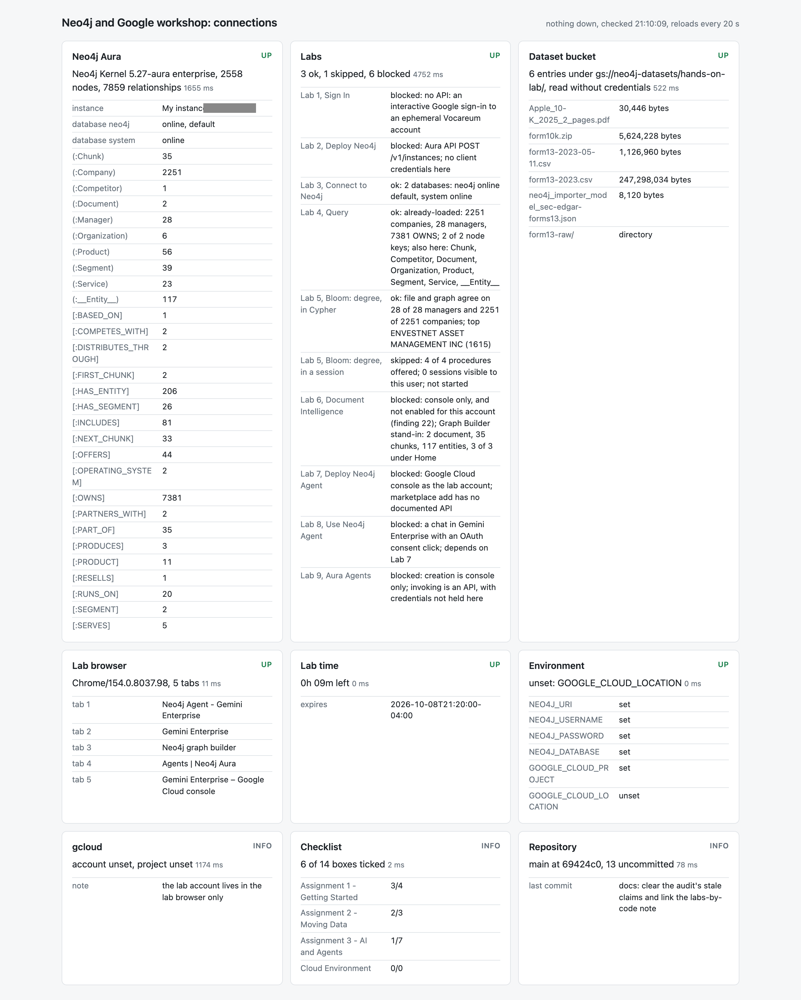

#+TITLE: Write-up: AI Workshop with Neo4j and Google
#+DATE: 2026-10-08

One page on the day. Everything here is ours unless it says "the lab says";
the detail and the screenshots are in the lab notes this links to.

* What the workshop is

Nine labs over one architecture ([[file:architecture.org][architecture]]): SEC Form 13 filings in
Cloud Storage, loaded into Neo4j AuraDB, then looked at four ways: Cypher,
Bloom, a document turned into a graph, and two agents that write Cypher for
you, one inside Gemini Enterprise and one inside Aura.

The data is small and real: one day's file has 28 managers, 2,251
securities and 7,381 holdings.

* What was done

| lab | outcome                                                                              |
|-----+--------------------------------------------------------------------------------------|
| 1-3 | done as written                                                                      |
|   4 | done; the load is also =bb form13 load=, checked against the file                    |
|   5 | done; degree centrality sized on the scene, and the same numbers without Bloom       |
|   6 | not available to this account; the same result through the LLM Graph Builder's API   |
|   7 | done: Neo4j Agent added to a Gemini Enterprise app from the marketplace              |
|   8 | done: three prompts; the shared database was not what the handout described          |
|   9 | done: an agent generated from one paragraph, exported, and its answers checked       |

* What held up

- *The keyed load.* Constraints first, MERGE on the key, relationships in
  batches. It is idempotent, and one function says whether a database holds
  what the file says it should. The same four statements ran on Aura and,
  with one word changed, on a local server.
- *Cypher templates.* The Aura agent's generated templates were correct and
  used the right property names. Every answer that came from one was right.
- *The file as the oracle.* Most checks here compare the database with the
  CSV, not with a screenshot. That is why they still run after the lab
  account is gone.

* What did not

- *Free-form Text2Cypher.* It guessed =m.name= for a property called
  =managerName=, got nothing, and the agent answered anyway with three
  plausible rows, two of them wrong ([[file:lab-09-aura-agents.org][lab 9]], finding 26). The right and the
  wrong answer look alike on the page.
- *A vague word settled by a tool nobody read.* "Uncommon" became "two to
  three owners, alphabetical, first ten"; the 805 single-owner companies
  were never in view (finding 27).
- *A shared writable demo.* By our turn the instructor's database held 28
  Bobs under four label schemes ([[file:lab-08-use-neo4j-agent.org][lab 8]], finding 28).
- *A schema as a guarantee.* A local model held to a JSON schema returned
  well-formed output that missed the one fact asked for
  (=experiments/006-structured-extraction=). What worked in the hosted tool
  was restricting which types an edge may join.
- *Two loads, one database.* Lab 4's node key on Company made Lab 6's
  extraction fail the moment the model produced a Company (finding 24).
- *The consoles.* Features differ by account, pages need a reload to show
  what was just made, and a scripted click can do nothing without saying
  so (findings 22 and 30).

* One fact, several stores

The same holdings were loaded as a property graph, RDF triples, datoms,
core.logic facts and plain maps (=experiments/002= to =004=,
[[file:review-2026-10-08.org][the review]]). The property graph and the triple stores are the same
family: an OWNS edge with properties is a reified statement in RDF and an
entity in Datalog. The differences that mattered were where identity lives
and whether a count filter is in the query language or in Clojure.

* What is in the repository

- =src/workshop/=: the driver, the dataset bucket, the Form 13 file as data,
  each lab as a function, a status page, redaction, diagrams, snapshots.
- =labs/=, =prompts/=: every statement and every prompt, one named file each.
- =experiments/=: eight numbered attempts, each with a gate and a log,
  including the ones that failed.
- =examples/=: what the commands printed on the day, and both agent
  conversations as text.
- =.meta/findings.md=: thirty things that bit, one entry each.

=bb dashboard=, ten minutes before the instance expired.

* To run it again

With another Aura instance: =gmake .env=, fill it, =bb ping=,
=bb form13 load=, then the labs in order from the table in =README.org=.
With none: =experiments/008-local-graph-dx=, =(session/up!)= in a REPL.
Labs 5, 7, 8 and 9 need the consoles, and Lab 6 needs either Document
Intelligence or the Graph Builder login.

* Never verified

- Whether the marketplace trial billed anything to the lab's subscription.
- Experiment 007's properties against the real Query tool; they ran against
  the replica only.
- gemma4:26b on the extraction: it timed out and was not retried.
- Emacs at a keyboard. One CIDER session was driven through tmux against
  the local graph ([[file:screens.org][screens]]); the other REPL files were evaluated by script.
